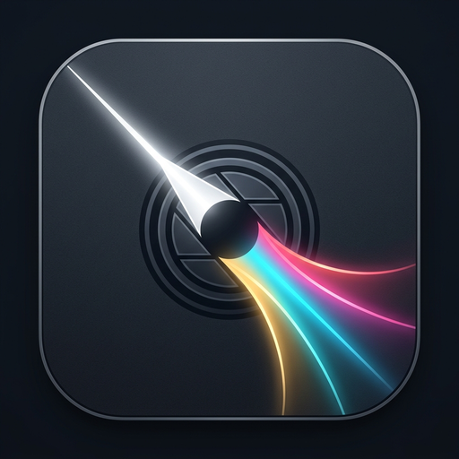

<p align="center">
  
</p>

<h1 align="center">beaM.</h1>

<p align="center">
  <strong>The Modern, Non-Destructive Desktop Photo Studio</strong><br />
  Professional RAW photo editing and local library management for Linux and Windows.
</p>

<p align="center">
  <a href="https://github.com/MOzcelik14/beaM/releases"></a>
  <a href="LICENSE"></a>
  
</p>

<p align="center">
  <a href="README.md">English</a> · <a href="README.tr.md">Türkçe</a>
</p>

---

## Welcome to beaM.

**beaM.** is an independent desktop photography application designed for photographers, digital artists, and visual creators who demand complete creative control, precise color reproduction, and absolute privacy over their work.

Built from the ground up to eliminate the friction, subscription models, and privacy compromises of legacy creative suites, beaM. delivers a fluid, studio-grade darkroom experience directly on your workstation. Your camera originals remain entirely untouched, adjustments are calculated in real time, and your catalog stays strictly local.

---

## Why Choose beaM.?

- **Complete Creative Ownership**: No accounts, no telemetry, and no mandatory cloud synchronization. Your images, edits, and presets remain exclusively on your local disks.
- **Pure Non-Destructive Editing**: Every crop, tone curve adjustment, and color grade is preserved in lightweight, human-readable `.beam` sidecar files. Your original RAW and raster files are never modified or overwritten.
- **Hardware-Accelerated Responsiveness**: Adjust sliders, evaluate high-resolution tone curves, and preview edits in real time with hardware-accelerated processing designed for modern multi-core systems.
- **Studio Color Fidelity**: Work with confidence across wide-gamut linear color spaces with industry-standard ICC profiles (sRGB, Display P3, Adobe RGB) to ensure your final prints and web exports match your exact artistic vision.

---

## Core Capabilities

### Color & Tone Precision
Sculpt light and shadow with professional-grade tonal tools:
- **Tonal Balance**: Responsive Exposure, Contrast, Highlights, and Shadows controls calibrated for wide dynamic range captures.
- **White Balance**: Precise Kelvin Temperature and Tint corrections for natural skin tones and accurate daylight rendering.
- **Parametric Tone Curve**: Interactive cubic-spline curve adjustment for granular control over highlights, midtones, and deep shadows.
- **8-Band HSL Color Grading**: Selective control over Hue, Saturation, and Lightness across eight dedicated chromatic channels (Red, Orange, Yellow, Green, Aqua, Blue, Purple, Magenta).

### Framing, Crop & Alignment
Compose your shot with precision:
- **Aspect Ratio Presets**: Standard framing presets including 1:1, 4:5, 3:2, 16:9, and freeform cropping.
- **Compositional Guides**: Golden ratio and rule-of-thirds overlays for balanced framing.
- **Horizon Straightening**: Smooth rotational leveling with automated border constraint to avoid empty canvas areas.

### Real-Time Inspection & Comparison
Evaluate your adjustments with instant visual feedback:
- **Before & After Modes**: Switch seamlessly between full-frame before/after toggles, interactive draggable split views, and side-by-side comparisons.
- **Exposure Clipping Overlays**: Live indicators highlight blown highlights and blocked shadow details before you export.
- **Dynamic Histogram**: Continuous RGB and luminance distribution display for technical exposure auditing.

### Effortless Local Asset Management
Organize your photographic projects without bloated database imports:
- **Direct Filesystem Browsing**: Browse directories instantly without lengthy import steps or proprietary catalog locks.
- **Culling & Rating**: Star ratings (1 to 5 stars), color labels, and rapid keyboard-driven navigation.
- **Metadata Inspection**: Instant review of EXIF details including camera make, lens model, shutter speed, aperture, and ISO.

### High-Fidelity Batch Export
Deliver finished work tailored for print or web:
- **Flexible Formats**: Export full-resolution captures to standard JPEG or pristine 8-bit/16-bit PNG.
- **Color Profile Embedding**: Automated tagging and conversion for sRGB, Display P3, and Adobe RGB color spaces.
- **Batch Processing & Templates**: Export entire albums in the background with customizable naming templates.

---

## Supported Formats

beaM. supports direct reading of popular digital camera RAW formats alongside standard image files:

| Format Category | Supported Extensions |
| :--- | :--- |
| **Camera RAW** | `.arw`, `.cr2`, `.cr3`, `.nef`, `.raf`, `.rw2`, `.dng`, `.pef`, `.orf` |
| **Standard Images** | `.jpg`, `.jpeg`, `.png`, `.tif`, `.tiff`, `.webp` |
| **Project & Edits** | `.beam` (non-destructive sidecar and project files) |

---

## Download & Getting Started

### Installation Packages
Pre-built packages are available for Linux and Windows on the [GitHub Releases](https://github.com/MOzcelik14/beaM/releases) page:

- **Debian / Ubuntu / Pop!_OS (`.deb`)**:
  ```bash
  sudo dpkg -i beam_1.0.0_amd64.deb
  sudo apt-get install -f
  ```
- **Fedora / RHEL / CentOS (`.rpm`)**:
  ```bash
  sudo rpm -i beam-1.0.0-1.x86_64.rpm
  ```
- **Universal Linux Portable (`.AppImage`)**:
  ```bash
  chmod +x beaM-1.0.0-x86_64.AppImage
  ./beaM-1.0.0-x86_64.AppImage
  ```
- **Windows 10 / 11 (64-bit)**:
  - **Installer**: Run `beaM-v1.0.0-windows-x86_64-setup.exe` for automatic installation with Start Menu integration and file associations.
  - **Portable**: Extract `beaM-v1.0.0-windows-x86_64.zip` and run `beam.exe` directly without installation.

### prisM. Suite Integration
If you use [prisM. Suite](https://github.com/MOzcelik14/prism-suite), **beaM.** can be installed, launched, and kept up to date automatically through the unified creative application manager.

---

## System Recommendations

| Component | Minimum Specification | Recommended Specification |
| :--- | :--- | :--- |
| **Operating System** | Windows 10/11 (64-bit) or Modern Linux (glibc 2.31+) | Windows 11 (64-bit) or Ubuntu 22.04+ / Fedora 38+ |
| **Processor** | 64-bit Dual-Core Processor | Modern Quad-Core / Multi-Core Processor |
| **Memory** | 4 GB RAM | 8 GB RAM or higher |
| **Graphics** | GPU with Vulkan 1.2+ or DirectX 12 support | Dedicated GPU with 2 GB+ VRAM |
| **Storage** | 150 MB free disk space for application | Fast NVMe / SSD recommended for high-resolution RAW files |

---

## Privacy & Security Commitment

**beaM.** is built on a strict privacy-first foundation:
- **No Analytics or Telemetry**: The application never phones home, collects personal metrics, or transmits user activity.
- **Offline Reliability**: Full functionality is available completely offline without an internet connection.
- **File Integrity**: Edits are stored independently from source media, guaranteeing zero risk of source file corruption.

---

## Developer Information

<details>
<summary>Building from Source (Optional)</summary>

For developers interested in compiling beaM. from source:

1. Install the Rust toolchain (Rust 1.89 or newer recommended):
   ```bash
   curl --proto '=https' --tlsv1.2 -sSf https://sh.rustup.rs | sh
   ```
2. Clone the repository and build the release binary:
   ```bash
   git clone https://github.com/MOzcelik14/beaM.git
   cd beaM
   cargo build --release -p beam-app
   ```
3. The executable will be generated at `target/release/beam`.

</details>

---

## License & Community

**beaM.** is free and open-source software distributed under the terms of the **GNU General Public License v3.0 (GPL-3.0)**. Refer to the [LICENSE](LICENSE) file for complete details.

- **Issue Tracker**: Report bugs and submit feature requests on our [GitHub Issues](https://github.com/MOzcelik14/beaM/issues) page.
- **Source Code**: Explore and contribute at [https://github.com/MOzcelik14/beaM](https://github.com/MOzcelik14/beaM).
