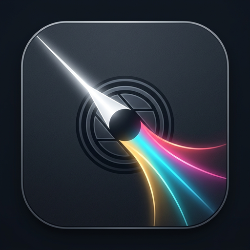

<p align="center">
  
</p>

<h1 align="center">beaM.</h1>

<p align="center">
  <strong>Professional, Non-Destructive RAW Photo Editor and Library Manager</strong><br>
  Built from first principles in 100% pure Rust, powered by wgpu and egui.
</p>

<p align="center">
  <a href="README.md"><strong>English</strong></a> | <a href="README.tr.md"><strong>Türkçe</strong></a>
</p>

<p align="center">
  <strong>Version:</strong> 0.2.0 &nbsp;|&nbsp;
  <strong>License:</strong> GNU General Public License v3.0 &nbsp;|&nbsp;
  <strong>Platforms:</strong> Linux, Windows &nbsp;|&nbsp;
  <strong>Architecture:</strong> x86_64
</p>

---

## Executive Overview

**beaM.** is an independent, high-performance desktop photo editing application engineered for photographers, imaging specialists, and visual artists who require complete control, color fidelity, and privacy over their creative assets.

Unlike legacy desktop suites burdened by monolithic C/C++ runtimes or cloud subscriptions, beaM. is built entirely in Rust. It utilizes **WebGPU (wgpu)** for hardware-accelerated image manipulation and **egui** for an immediate-mode user interface.

Every adjustment in beaM. is strictly non-destructive: original capture files remain bit-for-bit immutable on disk, while edits are stored in lightweight, versioned sidecar files.

---

## Engineering Highlights

### 1. Non-Destructive Sidecar Pipeline
The original capture data is never altered. Adjustments, tone curves, crops, and metadata are written to human-readable, git-diffable [RON](https://github.com/ron-rs/ron) sidecar files (`<filename>.beam` or standalone `.beam` project packages). Should you migrate, rename, or backup files, your edit history and camera raw data remain completely decoupled and preserved.

### 2. Linear Rec.2020 Working Color Space
Digital sensors capture physical photon counts that have a linear relationship to scene luminance. beaM. conducts all internal exposure, chromatic adaptation, and tonal transformations in **Linear Rec.2020 (ITU-R BT.2020)**:
- **Exposure scaling** performs physical photon doubling ($I' = I \cdot 2^{\text{EV}}$) without clipping artifacts.
- **Midtone contrast** pivots around 18% middle-gray ($M = 0.18$) using an exponential slope function:
  $$x' = M \cdot \left(\frac{x}{M}\right)^{2^{C / 100}}$$
- **White balance** applies chromatic adaptation coefficients derived from correlated color temperature (Kelvin) and Green-Magenta tint adjustments directly to linear channel amplitudes.
- Prior to screen rendering or file export, values are transferred to target color spaces (sRGB, Display P3, or Adobe RGB 1998) with standard embedded ICC profile generation.

### 3. Hardware-Accelerated wgpu Pipeline
Adjustments are executed on the GPU as discrete, modular WGSL shader passes between intermediate 32-bit floating-point textures (`Rgba32Float`). Interactive slider manipulation operates on an in-memory GPU proxy texture, delivering sub-millisecond redraws at native monitor refresh rates.

### 4. Zero-Seam Tiled Export Architecture
Exporting ultra-high-resolution images (40 MP, 60 MP, 100+ MP) often causes out-of-memory crashes on conventional image editors. beaM. features a specialized tiled export subsystem that partitions images exceeding 2048px into discrete processing blocks. Tiling runs with zero seam boundaries, keeping GPU memory usage strictly bounded below 70 MB regardless of output resolution.

### 5. Pure-Rust Media Stack
beaM. completely eliminates legacy C/C++ dependencies like LibRaw, libpng, or LibTIFF. Camera RAW parsing and demosaicing are handled natively through `rawler`. Standard raster formats (JPEG, PNG, TIFF, WebP) are decoded via pure-Rust crates, with ICC profile conversions orchestrated by `moxcms` and EXIF metadata extracted through `kamadak-exif`.

### 6. Local SQLite Photo Catalog
Library operations leverage an embedded, ACID-compliant SQLite catalog (`beam-library`). It indexes photo directories, tracks star ratings (0–5), color labels, and camera metadata, and maintains a thread-safe thumbnail cache without background queue deadlocks.

---

## Application Modules

### Develop Module
- **Primary Tone**: Exposure (-5.0 to +5.0 EV), Contrast (-100 to +100), Highlights, Shadows.
- **Color Balance**: Temperature (2000K to 12000K), Tint (-100 to +100).
- **Tone Curve**: Interactive spline editor supporting parametric and point curve adjustments.
- **8-Band HSL**: Dedicated Hue, Saturation, and Luminance sliders for Red, Orange, Yellow, Green, Aqua, Blue, Purple, and Magenta bands.
- **Crop & Geometry**: Freeform and aspect-constrained cropping (1:1, 4:5, 3:2, 16:9), 90-degree rotations, horizontal/vertical flips, and a high-precision continuous straighten slider (-45.0° to +45.0°).
- **Comparison Views**:
  - *Toggle (`\`)*: Rapid single-key switch between processed and original proxy.
  - *Split View*: Draggable interactive divider comparing before and after slices in a unified viewport.
  - *Side-by-Side*: Concurrent dual-viewport inspection with synchronized zoom and pan.
- **Inspection**: Live RGB and luminance histogram with clipping indicator overlays (`J`) for blown highlights and crushed shadows.
- **History & Presets**: 50-step linear undo/redo stack with jump-to-step history panel, reusable user presets, and cross-photo settings synchronization.

### Library Module
- **File Browser & Ingestion**: RawTherapee-style in-app directory navigation with quick Places, persistent bookmarks, subfolder browsing, optional recursive scanning, and protection against symlink loops.
- **Metadata Inspection**: Lens, focal length, ISO, shutter speed, aperture, and camera model display.
- **Filtering & Search**: Filter by star rating, color label, file extension, or text query.
- **Filmstrip Navigation**: Collapsible bottom tray in Develop mode for rapid image switching.

### Export Subsystem
- **Format Support**: 8-bit JPEG (configurable quality 1–100) and 8/16-bit PNG.
- **Color Profiles**: sRGB, Display P3, and Adobe RGB (1998) with embedded ICC tags.
- **Rescaling & Sharpening**: Lanczos3 scaling (original, long-edge, percentage, explicit dimensions) and configurable unsharp mask (Screen or Print).
- **Batch Processing**: Background batch exporter with live progress monitoring, cancellation support, and dynamic filename templates (`{name}`, `{date}`, `{rating}`, `{counter}`).

---

## Supported File Formats

| Category | Formats / Extensions | Bit Depth & Capabilities |
| :--- | :--- | :--- |
| **Camera RAW** | `.arw`, `.cr2`, `.cr3`, `.nef`, `.raf`, `.rw2`, `.dng`, `.pef`, `.orf` | Native pure-Rust decode, demosaicing, linear sensor response |
| **Raster Formats** | JPEG (`.jpg`, `.jpeg`), PNG (`.png`), TIFF (`.tif`, `.tiff`), WebP (`.webp`) | 8-bit and 16-bit channel preservation, embedded ICC transforms |
| **Sidecars & Projects** | `.beam`, `.beam.ron` | Human-readable RON format, lossless migration, backward-compatible |

---

## System Requirements

- **Operating System**: Linux (glibc 2.31+, modern desktop environment) or Windows 10/11 (64-bit).
- **Graphics Hardware**: GPU with Vulkan 1.2+ support (Linux/Windows) or DirectX 12 support (Windows).
  - *Linux*: Mesa Vulkan drivers (`mesa-vulkan-drivers`) or proprietary Nvidia drivers (525+).
  - *Windows*: Modern Intel, AMD, or Nvidia graphics drivers.
- **Memory**: 4 GB RAM minimum (8 GB recommended for large batch exports).
- **Storage**: Approximately 50 MB disk space for the binary.

---

## Installation and Quick Start

### Packages and Pre-built Binaries
Download the latest pre-compiled distribution packages for your operating system from the [GitHub Releases](https://github.com/MOzcelik14/beaM/releases) page:

- **Debian / Ubuntu / Pop!_OS (`.deb`)**:
  ```bash
  sudo dpkg -i beam_0.2.0_amd64.deb
  sudo apt-get install -f  # resolve any missing recommended runtime dependencies
  ```
- **Fedora / RHEL / Rocky Linux (`.rpm`)**:
  ```bash
  sudo rpm -i beam-0.2.0-1.x86_64.rpm
  ```
- **Universal Linux Portable (`.AppImage`)**:
  ```bash
  chmod +x beaM-0.2.0-x86_64.AppImage
  ./beaM-0.2.0-x86_64.AppImage
  ```
- **Windows Setup (`.exe`) & Portable (`.zip`)**:
  - Run `beaM-v0.2.0-windows-x86_64-setup.exe` for full installation with Start Menu shortcuts and `.beam`/RAW file associations.
  - Or extract `beaM-v0.2.0-windows-x86_64.zip` and run `beam.exe` standalone.

### Packaging from Source
You can generate all distribution packages locally using the unified scripts in `packaging/`:
- **Linux (`.deb`, `.rpm`, `.AppImage`, `.tar.gz`)**:
  ```bash
  ./packaging/linux/build-linux.sh
  ```
- **Windows (Portable `.zip` and Inno Setup `.exe`)**:
  ```powershell
  .\packaging\windows\build-windows.ps1
  ```

### Building from Source

Ensure you have a modern Rust toolchain installed (Rust 1.89+ recommended, 2021 edition):

```bash
# Clone the repository
git clone https://github.com/MOzcelik14/beaM.git
cd beaM

# Build optimized binary
cargo build --release

# Launch application
./target/release/beam
```

You can pass an image path directly to open it immediately:
```bash
./target/release/beam /path/to/photograph.ARW
```

### Testing and Code Quality
The codebase is validated with comprehensive unit, property, and integration tests:

```bash
# Run workspace test suite
cargo test --workspace

# Validate formatting and linter guidelines
cargo fmt --check
cargo clippy --workspace --all-targets -- -D warnings
```

---

## Keyboard Shortcuts

| Shortcut | Context | Action |
| :--- | :--- | :--- |
| `G` | Global | Switch to Library Grid View |
| `D` | Global | Switch to Develop View |
| `Ctrl + O` | Global | Open Image File |
| `Ctrl + Shift + O` | Global | Import Folder to Library |
| `Ctrl + S` | Develop | Save Current Edits to Sidecar / Project |
| `Ctrl + Shift + S` | Develop | Save Project As... |
| `Ctrl + W` | Develop | Close Project (with Unsaved Changes prompt) |
| `Ctrl + E` | Global | Open Export Dialog |
| `Ctrl + Z` | Develop | Undo Edit Step |
| `Ctrl + Shift + Z` / `Ctrl + Y` | Develop | Redo Edit Step |
| `\` | Develop | Toggle Before / After View |
| `C` | Develop | Toggle Interactive Crop Tool |
| `J` | Develop | Toggle Highlight / Shadow Clipping Overlays |
| `Z` | Develop | Toggle Zoom to Fit / 100% (1:1) View |
| `F` / `F11` | Global | Toggle Fullscreen Mode |
| `0` – `5` | Global | Set Photo Star Rating (0 to 5 stars) |
| `6` – `9` | Global | Set Color Label (Red, Yellow, Green, Blue) |
| `Left` / `Right` Arrow | Global | Navigate to Previous / Next Photograph |
| `Ctrl + ,` | Global | Open Application Settings |

---

## Architecture Overview

```
beaM/
├── Cargo.toml                # Workspace manifest defining shared crate dependencies
├── crates/
│   ├── beam-app/             # Desktop application shell, egui UI layout, event loop
│   ├── beam-core/            # EditStack models, linear Rec.2020 color math, sidecars, i18n
│   ├── beam-gpu/             # wgpu context, render pipeline, WGSL shader passes
│   ├── beam-media/           # RAW decoding, raster format handling, tiled export, EXIF/ICC
│   └── beam-library/         # SQLite photo catalog, metadata indexing, thumbnail worker
├── locales/                  # Mozilla Project Fluent translation catalogs (en.ftl, tr.ftl)
├── shaders/                  # Hardware-accelerated WGSL shaders
└── docs/                     # Documentation and official GitHub Pages website
```

---

## Internationalization

beaM. includes complete bilingual localization for **English** and **Turkish**, powered by Mozilla Project Fluent (`fluent-bundle`). Language preferences can be changed dynamically in Settings (`Ctrl+,`) with instant UI repainting, and catalogs are verified at compile time for 100% key parity.

To contribute a new translation catalog, refer to the documentation in [crates/beam-core/src/i18n.rs](crates/beam-core/src/i18n.rs).

---

## Security and Robustness

beaM. underwent an in-depth security and robustness audit. Key security properties include:
- Zero `unsafe` blocks and zero memory transmutation throughout application code.
- Continuous 10-minute fuzzing coverage across RAW decoders, raster parsers, EXIF blocks, and ICC profile engines.
- Strict path sanitization preventing path traversal attacks during file export and sidecar serialization.
- Hardened protection against decompression bombs, cyclic symlinks, and malformed container structures.

For full audit records and reproducibility metrics, review [SECURITY_AUDIT.md](SECURITY_AUDIT.md).

---

## License

beaM. is free and open-source software distributed under the terms of the **GNU General Public License v3.0 (GPL-3.0-only)**. See the [LICENSE](LICENSE) file for details.
