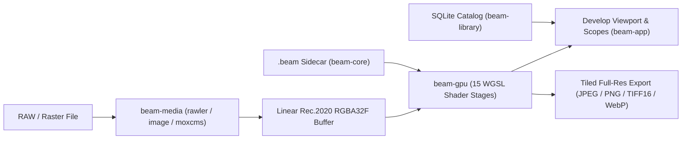

<p align="right">
  <strong>English</strong> | <a href="README.tr.md">Türkçe</a>
</p>

<div align="center">

<h1>beaM.</h1>

<p>Non-destructive RAW photo development and local library management built in Rust.</p>

<p>
  <a href="LICENSE"></a>
  <a href="https://github.com/MOzcelik14/beaM/releases"></a>
  <a href="https://www.rust-lang.org/"></a>
  <a href="#system-requirements"></a>
  <a href="https://github.com/MOzcelik14/beaM/actions/workflows/release.yml"></a>
  <a href="https://github.com/MOzcelik14/beaM/commits/master"></a>
  <a href="https://github.com/MOzcelik14/prism-suite"></a>
</p>

<p>
  <a href="#overview">Overview</a> |
  <a href="#features">Features</a> |
  <a href="#installation">Installation</a> |
  <a href="#getting-started">Getting Started</a> |
  <a href="#keyboard-shortcuts">Keyboard Shortcuts</a> |
  <a href="#supported-formats">Formats</a> |
  <a href="#architecture">Architecture</a> |
  <a href="#development">Development</a>
</p>

<p>
  
</p>

</div>

---

## Overview

**beaM.** is a desktop RAW photo developer and local catalog manager designed for photographers who want predictable color processing, fast local browsing, and full control over their files. The application runs entirely offline with no accounts, no telemetry, and no cloud dependencies.

Every edit is non-destructive. Camera originals and raster images are never modified; adjustments, edit history, named snapshots, ratings, and color labels are stored in human-readable `.beam` sidecar files alongside your photos. A local SQLite catalog indexes folders, metadata, tags, smart collections, and thumbnails while leaving your directory structure intact.

The imaging pipeline is written entirely in Rust. RAW files are decoded directly in pure Rust via `rawler` without external native RAW libraries, converted into a wide-gamut linear working space (Linear Rec.2020, 32-bit floating point per channel), and processed on the GPU through modular WGSL compute and render shaders via `wgpu`. Interactive editing uses an up to 1920 px proxy buffer for responsive slider feedback, while 1:1 inspection and export render at full resolution with automatic tiled processing for high-megapixel images.

## Highlights

- **Pure-Rust RAW Decoding**: Reads camera RAW formats directly through `rawler` with bounded file size, dimension, and memory safeguards, plus full-precision raster decoding for JPEG, PNG, TIFF, and WebP.
- **Wide-Gamut GPU Pipeline**: Processes edits in 32-bit floating-point Linear Rec.2020 space across modular WGSL shader stages using `wgpu`, with automatic tiled rendering for large images.
- **Non-Destructive Sidecars**: Stores complete edit stacks, undo history, named snapshots, ratings, and color labels in atomic, human-readable `.beam` RON files without touching original media.
- **Complete Local Catalog**: Organizes folders with SQLite indexing, virtual copies, star ratings, color labels, tags, smart collections, IPTC/XMP metadata editing, duplicate detection, and folder watching (auto-import).
- **Color-Managed Output**: Supports soft proofing with out-of-gamut overlays, real-time scopes (Histogram, Waveform, RGB Parade, Vectorscope), and full-resolution single or batch export in JPEG, PNG, 16-bit TIFF, and WebP with embedded ICC profiles.

## Features

### Tone, Color, and Detail

| Feature | Details |
| :--- | :--- |
| White Balance | Temperature (-100 to +100) and Tint (-100 to +100) adjustments in linear space. |
| Exposure and Tone | Exposure (-5.0 to +5.0 EV), Contrast (-100 to +100), Highlights, Shadows, Whites, and Blacks (-100 to +100). |
| Tone Curve | Interactive cubic-spline tone curve with independent Master, Red, Green, and Blue channels. |
| 8-Band HSL | Independent Hue, Saturation, and Luminance sliders for Red, Orange, Yellow, Green, Aqua, Blue, Purple, and Magenta. |
| Vibrance and Saturation | Selective vibrance and global saturation controls (-100 to +100). |
| 3-Way Color Grading | Shadows, Midtones, and Highlights color wheels with Hue, Saturation, Luminance, Balance, and Blending controls. |
| Camera Profiles | Built-in Standard, Neutral, Vivid, Portrait, Landscape, and Monochrome rendering profiles. |
| Detail and Noise Reduction | Clarity, Dehaze, Edge Sharpening, Luminance Noise Reduction, Color Noise Reduction, and a local 5x5 edge-preserving Smart Denoise filter. |
| 3D LUT Support | Loads `.cube` 3D LUT files with adjustable blend intensity (0 to 100%). |
| Vignette and Film Grain | Post-crop vignette (amount, midpoint, feather) and procedural film grain (amount, particle size). |

### Local Adjustments and Optics

| Feature | Details |
| :--- | :--- |
| Mask Shapes | Linear Gradient, Radial Gradient (with feather and invert), and Brush stroke masks (with radius, feather, and invert). |
| Range Restrictions | Luminance range masking (min, max, smoothness) and Color Range hue masking (target hue and tolerance). |
| Auto Selection Masks | Local heuristic Auto Sky and Auto Subject mask generators operating directly on the RGBA32F image buffer. |
| Per-Mask Controls | Independent Exposure, Contrast, Highlights, Shadows, Temperature, Tint, and Saturation per mask layer. |
| Lens and Perspective | Barrel/pincushion distortion, Red/Cyan and Blue/Yellow lateral chromatic aberration, optical vignette, and vertical/horizontal perspective (keystone) correction. |
| Crop and Geometry | Non-destructive crop with Original, 1:1, 4:5, 3:2, 16:9, and Free aspect presets; 90-degree rotations, horizontal/vertical flips, and -45 to +45 degree horizon straightening. |

### Inspection, Proofing, and Workflow

| Feature | Details |
| :--- | :--- |
| Real-Time Scopes | RGB, Luminance, Red, Green, and Blue histograms alongside Waveform, RGB Parade, and Vectorscope views. |
| Before and After | Full-frame toggle, interactive draggable split view, and side-by-side comparison modes. |
| Diagnostic Overlays | Highlight and shadow clipping warnings, Soft Proofing with Out-of-Gamut warning, and Focus Peaking overlay. |
| Presets and Copy/Paste | 8 built-in presets, custom user presets saved in RON format, and selective Copy/Paste of adjustment groups across photos. |
| History and Snapshots | Step-by-step undo/redo history and named snapshots persisted inside the `.beam` sidecar. |
| CLI Plugins | Extensible external CLI plugin discovery and execution via `.ron` manifests in the user plugins directory (Filter, Export, Analyze categories). |

### Library and Asset Management

| Feature | Details |
| :--- | :--- |
| Folder Browsing and Catalog | SQLite-backed catalog with recursive or non-recursive browsing, folder bookmarks, thumbnail caching, and missing-file relinking. |
| Culling and Filtering | 0-5 star ratings, color labels (Red, Yellow, Green, Blue, Purple), file type filters (All, RAW, JPEG, PNG, TIFF, WebP), text search, and sorting (Date, Rating, Filename). |
| Tags and Smart Collections | Multi-photo tagging, tag filtering, and saved Smart Collections that store reusable filter combinations. |
| Virtual Copies | Multiple independent `.beam` edit stacks linked to the same source photo without duplicating media files. |
| Metadata and GPS | EXIF readout (camera, lens, ISO, shutter speed, aperture, focal length), editable IPTC/XMP fields (title, caption, creator, copyright), and GPS coordinate storage with external map links. |
| Duplicates and Folder Watch | Duplicate photo detection within the library and folder watching (auto-import) to ingest new files automatically. |

### Export Pipeline

| Feature | Details |
| :--- | :--- |
| Output Formats | JPEG (configurable quality), 8-bit PNG, 16-bit TIFF (`Tiff16`), and WebP. |
| Color Management | Conversion and ICC profile embedding for sRGB, Display P3, and Adobe RGB (1998) via `moxcms`. |
| Resizing and Sharpening | Original size, Long Edge, Percentage, or Exact dimensions (with optional aspect lock), plus None, Screen, or Print output unsharp masking. |
| Batch Export and Templates | Background single or multi-photo export with cancellation support, EXIF orientation sanitization, atomic file writes, and safe filename templates (`{name}`, `{date}`, `{counter}`, `{rating}`). |

## Screenshots

| Develop Workspace | Library Catalog |
| :---: | :---: |
|  |  |

## Installation

### Pre-Built Packages (GitHub Releases)

Pre-built binaries and installers for 64-bit Linux (`x86_64`) and Windows (`x86_64`), along with `SHA256SUMS.txt` checksums, are published on the [GitHub Releases](https://github.com/MOzcelik14/beaM/releases) page.

#### Debian / Ubuntu (`.deb`)

```bash
sudo dpkg -i beam_1.2.6_amd64.deb
sudo apt-get install -f
```

#### Fedora / RHEL / openSUSE (`.rpm`)

```bash
sudo rpm -i beam-1.2.6-1.x86_64.rpm
```

#### Universal Linux Portable (`.AppImage`)

```bash
chmod +x beaM-1.2.6-x86_64.AppImage
./beaM-1.2.6-x86_64.AppImage
```

#### Portable Linux Archive (`.tar.gz`)

```bash
tar -xzf beam-v1.2.6-linux-x86_64.tar.gz
./beam-v1.2.6-linux-x86_64/beam
```

#### Windows (64-bit)

- **Installer**: Download and run `beaM-v1.2.8-windows-x86_64-setup.exe`. Optional tasks include Start Menu shortcuts, desktop icon, `.beam` project association, and camera RAW file association.
- **Portable**: Extract `beaM-v1.2.8-windows-x86_64.zip` and launch `beam.exe`.

#### macOS (Apple Silicon / arm64)

- **Disk Image (`.dmg`)**: Download `beaM-v1.2.8-macos-arm64.dmg`, open it, and drag `beaM..app` to `/Applications`.
- **Portable Archive (`.tar.gz`)**: Extract `beaM-v1.2.8-macos-arm64.tar.gz` and run `./beaM-v1.2.8-macos-arm64/beam`.

### Building from Source

#### Prerequisites

- Rust toolchain (MSRV 1.95+, Rust 2021 edition; install via [rustup](https://rustup.rs/)).
- A GPU driver supporting Vulkan (Linux/Windows), DirectX 12 (Windows), or Metal (macOS).
- Standard C/system build tools (`gcc` or `clang`, `pkg-config`, and Wayland/X11 development headers on Linux). SQLite is bundled via `rusqlite`, and RAW decoding is pure Rust, so no external `libsqlite3` or `libraw` headers are required.

#### Compile and Run

```bash
git clone https://github.com/MOzcelik14/beaM.git
cd beaM
cargo build --release -p beam-app
./target/release/beam
```

You can also open a photo or `.beam` project file directly from the command line:

```bash
./target/release/beam /path/to/photo.ARW
```

## Getting Started

1. **Launch beaM.** Start the application from your system launcher or run `beam` from a terminal.
2. **Import a Folder.** Press `Ctrl+Shift+O` (or click **Import Folder** in the Library view) and select a directory containing RAW or raster photographs. beaM. indexes the folder into its local SQLite catalog and generates cached thumbnails without moving or altering your files.
3. **Cull and Organize.** Browse the grid in Library view (`G`). Use keys `0`-`5` to assign star ratings, `6`-`9` for color labels, and the left sidebar to filter by rating, color, format, tag, or Smart Collection.
4. **Open in Develop.** Double-click a photo or press `D` to switch to the Develop workspace.
5. **Apply Non-Destructive Edits.** Adjust White Balance, Exposure, Tone Curve, HSL, Color Grading, Detail, Lens Correction, or Local Masks in the right panel. Toggle Before/After with `\` and inspect exposure clipping with `J`.
6. **Save Sidecar.** Press `Ctrl+S` to write your edit stack, history, and snapshots to the companion `.beam` file.
7. **Export Finished Images.** Press `Ctrl+E` to open the Export dialog, select the output format (JPEG, PNG, 16-bit TIFF, or WebP), color space, resizing mode, and filename template, then export.

## Keyboard Shortcuts

Shortcuts can be configured in **Settings** (`Ctrl+,`). Single-key shortcuts are automatically disabled while typing in text fields.

| Shortcut | Action | Context |
| :--- | :--- | :--- |
| `Ctrl+O` | Open photo or `.beam` project file | Global |
| `Ctrl+Shift+O` | Import folder into Library | Global |
| `Ctrl+S` | Save current `.beam` sidecar / project | Global |
| `Ctrl+Shift+S` | Save project as | Global |
| `Ctrl+W` | Close active project | Global |
| `Ctrl+E` | Open Export dialog | Global |
| `Ctrl+,` | Open Settings | Global |
| `Ctrl+Z` | Undo last edit | Global |
| `Ctrl+Shift+Z` / `Ctrl+Y` | Redo edit | Global |
| `G` | Switch to Library (Grid) view | Global |
| `D` | Switch to Develop view | Global |
| `F` / `F11` | Toggle fullscreen mode | Global |
| `\` | Toggle Before / After comparison | Global |
| `Left` / `PageUp` | Previous photo | Global |
| `Right` / `PageDown` | Next photo | Global |
| `0` - `5` | Set star rating (0 clears rating) | Global / Library |
| `6` / `7` / `8` / `9` | Set color label (Red / Yellow / Green / Blue) | Global |
| `C` | Toggle Crop and Straighten mode | Develop |
| `Enter` / `Escape` | Exit Crop mode | Develop (Crop active) |
| `Z` | Toggle 100% (1:1) zoom and Fit to Screen | Develop |
| `J` | Toggle highlight and shadow clipping warnings | Develop |
| `Ctrl+C` | Copy selected adjustment groups | Develop |
| `Ctrl+V` | Paste adjustment groups onto active photo | Develop |

## Supported Formats

### Input Formats

| Category | Extensions | Notes |
| :--- | :--- | :--- |
| Camera RAW | `.arw`, `.cr2`, `.cr3`, `.nef`, `.raf`, `.rw2`, `.dng`, `.pef`, `.orf` | Decoded in pure Rust via `rawler` into Linear Rec.2020 RGBA32F. |
| Raster Images | `.jpg`, `.jpeg`, `.png`, `.tif`, `.tiff`, `.webp` | Decoded via `image` with 16-bit preservation and embedded ICC transform via `moxcms`. |
| Projects and Sidecars | `.beam`, `.beam.ron` (legacy) | Human-readable RON files storing edit stacks, history, snapshots, ratings, and labels. |
| 3D LUTs | `.cube` | Standard 3D lookup tables applied on the GPU. |

Decode safety limits enforced in `beam-media`: maximum 32,768 px per dimension, 150 megapixels total, 500 MB source file size, 1 GB decode allocation, and 4 MB embedded ICC profile size.

### Export Formats

| Format | Extension | Bit Depth | ICC Profile | Notes |
| :--- | :--- | :--- | :--- | :--- |
| JPEG | `.jpg` | 8-bit | sRGB, Display P3, Adobe RGB (1998) | Configurable quality (default 90), EXIF metadata preserved with sanitized orientation. |
| PNG | `.png` | 8-bit | sRGB, Display P3, Adobe RGB (1998) | Lossless compression. |
| TIFF (16-bit) | `.tif` | 16-bit | sRGB, Display P3, Adobe RGB (1998) | True 16-bit GPU readback for wide-gamut archival and print workflows. |
| WebP | `.webp` | 8-bit | sRGB, Display P3, Adobe RGB (1998) | Compact web delivery format. |

## Configuration and Data

beaM. follows XDG Base Directory conventions on Linux and standard AppData directories on Windows.

| Data Type | Linux Default Path | Windows Default Path | Format |
| :--- | :--- | :--- | :--- |
| User Configuration | `$XDG_CONFIG_HOME/beam/config.ron` (fallback `~/.config/beam/config.ron`) | `%APPDATA%\beam\config.ron` | RON |
| User Presets | `$XDG_CONFIG_HOME/beam/presets/` (fallback `~/.config/beam/presets/`) | `%APPDATA%\beam\presets\` | `.ron` |
| CLI Plugins | `$XDG_CONFIG_HOME/beam/plugins/` (fallback `~/.config/beam/plugins/`) | `%APPDATA%\beam\plugins\` | `.ron` manifests |
| Library Catalog | `$XDG_DATA_HOME/beam/catalog.db` (fallback `~/.local/share/beam/catalog.db`) | `%APPDATA%\beam\catalog.db` | SQLite 3 |
| Thumbnail Cache | `$XDG_CACHE_HOME/beam/thumbnails/` (fallback `~/.cache/beam/thumbnails/`) | `%LOCALAPPDATA%\beam\thumbnails\` | Cached thumbnails |
| Edit Sidecars | Next to each source image (`photo.ARW.beam`) | Next to each source image (`photo.ARW.beam`) | RON (max 5 MB) |

## System Requirements

| Component | Minimum | Recommended |
| :--- | :--- | :--- |
| Operating System | 64-bit Linux (`glibc` 2.31+, Wayland or X11), Windows 10 (64-bit), or macOS 13+ (Apple Silicon) | Modern Linux distribution, Windows 11 (64-bit), or macOS 14+ (Apple Silicon) |
| Graphics API | GPU with Vulkan, DirectX 12, or Metal support (`wgpu`) | Dedicated GPU with 2 GB+ VRAM (or Apple Silicon unified memory) for high-resolution RAW editing |
| Display | 800 x 600 minimum window resolution | 1920 x 1080 or higher, color-calibrated display |
| Memory | 4 GB RAM | 8 GB RAM or higher (recommended for 50 MP - 100 MP RAW files) |
| Storage | Local SSD or HDD for catalog and thumbnail cache | SSD / NVMe for fast RAW decoding and batch exports |

## Architecture

beaM. is organized as a five-crate Cargo workspace with strict separation between core data models, GPU shaders, media I/O, catalog persistence, and desktop UI.

| Crate | Path | Responsibility |
| :--- | :--- | :--- |
| `beam-core` | `crates/beam-core` | Color math (Linear Rec.2020 matrices, tone curves), `.beam` sidecar serialization, geometry/crop math, `.cube` LUT parser, presets, local sky/subject segmentation heuristics, CLI plugin manifest runner, and Fluent i18n. |
| `beam-gpu` | `crates/beam-gpu` | `wgpu` device/queue management, 15 modular WGSL shader stages (`shaders/*.wgsl`), ping-pong RGBA32F render execution, headless GPU export, and automatic tiled rendering. |
| `beam-media` | `crates/beam-media` | Pure-Rust RAW decoding (`rawler`), raster decoding (`image`), EXIF extraction (`kamadak-exif`), ICC color transforms (`moxcms`), proxy/thumbnail generation, and single/batch export. |
| `beam-library` | `crates/beam-library` | SQLite catalog schema and migrations (`rusqlite`), recursive folder scanning with symlink cycle protection, tags, smart collections, virtual copies, IPTC/XMP metadata, and duplicate detection. |
| `beam-app` | `crates/beam-app` | Native desktop application (`eframe` / `egui`), Library and Develop views, interactive curve/color wheel/crop/mask/scope widgets, background worker threads, and keyboard shortcuts. |



## Roadmap

### Completed Milestones

- **v0.1.0 - v0.2.0**: Application skeleton, non-destructive `.beam` sidecar format, initial RAW decoding, and GPU edit pipeline.
- **v0.8.0 - v1.0.0**: Full tonal/color adjustment suite (Tone Curve, 8-band HSL, 3-Way Color Grading, Detail, 3D LUTs, Crop/Straighten), SQLite Library catalog, thumbnails, presets, and batch export.
- **v1.1.0**: Pipeline accuracy, memory safety hardening, and security audit fixes.
- **v1.2.0**: True 16-bit GPU TIFF export with ICC profiles, manual lens and perspective correction, Soft Proofing with Out-of-Gamut and Focus Peaking overlays, Waveform/RGB Parade/Vectorscope, Brush/Luminance/Color Range masks, Camera Profiles, Named Snapshots, Tags, Smart Collections, IPTC/XMP metadata, GPS links, Duplicate Detection, and Folder Watch (Auto-Import).
- **v1.2.5 - v1.2.6**: Local 5x5 edge-preserving Smart Denoise, Auto Sky and Auto Subject heuristic masks, CLI Plugin Architecture, and Library layout fixes.

### Planned Direction

Future work focuses on broader camera profile and RAW format coverage as upstream `rawler` evolves, additional community localizations, and ongoing performance and usability refinements tracked on [GitHub Issues](https://github.com/MOzcelik14/beaM/issues).

## FAQ and Troubleshooting

**Does beaM. modify my original RAW or JPEG files?**
No. All edits, crop geometry, masks, history steps, ratings, and snapshots are saved separately in `.beam` sidecar files. Deleting a `.beam` file returns the image to its unedited state.

**Why does beaM. fail to start or show a blank canvas on Linux?**
beaM. relies on `wgpu` over Vulkan. Ensure your GPU driver and Vulkan ICD loader are installed (for example, `mesa-vulkan-drivers` on Debian/Ubuntu or `vulkan-loader` on Fedora). You can run `RUST_LOG=info beam` from a terminal to inspect adapter selection logs.

**How do I reset panel widths or application preferences?**
Close beaM. and remove or edit `config.ron` (`~/.config/beam/config.ron` on Linux or `%APPDATA%\beam\config.ron` on Windows). Your `.beam` sidecars and `catalog.db` will not be affected.

**What happens if I move photo folders outside of beaM.?**
The Library view detects missing file paths and provides a relink option to point catalog entries to their new folder location without losing ratings, tags, or sidecar associations.

**Can beaM. export very large RAW files (50 MP - 100 MP) on GPUs with limited VRAM?**
Yes. When an image exceeds GPU texture dimension or memory limits, `beam-gpu` automatically switches to tiled rendering, processing the full-resolution image in overlapping tiles and stitching the result for export.

**How do CLI plugins work?**
Place a valid `.ron` plugin manifest (`id`, `name`, `description`, `command`, `args`, `category`) inside your user plugins directory (`~/.config/beam/plugins/` or `%APPDATA%\beam\plugins\`). beaM. discovers and validates manifests up to 64 KB and executes them on demand from the UI.

**How do I switch the interface language?**
Open **Settings** (`Ctrl+,`) and choose between English and Türkçe. On first launch, beaM. detects the system locale automatically and falls back to English for unsupported locales.

## Development

### Common Commands

```bash
# Check formatting
cargo fmt --all -- --check

# Run Clippy linter across all targets and features
cargo clippy --all-targets --all-features -- -W clippy::all

# Run the full workspace test suite
cargo test --workspace

# Build an optimized release binary
cargo build --release -p beam-app
```

### Packaging Scripts

- Linux (`.tar.gz`, `.deb`, `.rpm`, `.AppImage`): `./packaging/linux/build-linux.sh`
- Windows (portable `.zip` and Inno Setup `.exe`): `.\packaging\windows\build-windows.ps1`

### Commit Convention

This repository uses Conventional Commits (for example, `feat(gpu): ...`, `fix(library): ...`, `docs: ...`, `chore(release): ...`).

### Repository Layout

```text
beaM/
├── .github/workflows/   # Automated Linux & Windows release workflow
├── assets/              # Application icons and logo
├── crates/
│   ├── beam-app/        # Desktop UI, views, and widgets
│   ├── beam-core/       # Color math, sidecars, LUTs, presets, plugins, i18n
│   ├── beam-gpu/        # wgpu render/compute pipeline and tiled export
│   ├── beam-library/    # SQLite catalog, tags, smart collections, metadata
│   └── beam-media/      # RAW/raster decoding, EXIF, ICC, and batch export
├── docs/                # Project website and documentation assets
├── fuzz/                # Fuzzing targets (excluded from default workspace)
├── locales/             # Fluent translation files (en.ftl, tr.ftl)
├── packaging/           # .desktop, AppStream metainfo, MIME, Linux & Windows scripts
└── shaders/             # 15 WGSL shader stages
```

## Contributing

Bug reports, feature proposals, translations, and pull requests are welcome via [GitHub Issues](https://github.com/MOzcelik14/beaM/issues) and pull requests.

Before opening a pull request:

1. Run `cargo fmt --all -- --check` to ensure consistent formatting.
2. Run `cargo clippy --all-targets --all-features -- -W clippy::all` with zero new warnings.
3. Run `cargo test --workspace` and add unit tests for new behavior or bug fixes.
4. Keep changes focused and follow the existing Conventional Commit message style.

## Localization

beaM. uses [Fluent](https://projectfluent.org/) (`.ftl`) translation files compiled into `beam-core`.

| Language | Locale Code | File |
| :--- | :--- | :--- |
| English | `en` | `locales/en.ftl` |
| Türkçe | `tr` | `locales/tr.ftl` |

### Adding a New Language

1. Copy `locales/en.ftl` to `locales/<code>.ftl` and translate all message keys.
2. Register the new `Language` variant and `include_str!` resource in `crates/beam-core/src/i18n.rs`.
3. Run `cargo test -p beam-core test_translations_parity` to verify key parity across all locale files.

## License

beaM. is free and open-source software licensed under the **GNU General Public License v3.0 only** (`GPL-3.0-only`). See the [LICENSE](LICENSE) file for the full license text.

## Acknowledgements

beaM. is built with the following open-source Rust crates:

| Library | Role | License |
| :--- | :--- | :--- |
| `eframe` / `egui` / `egui-wgpu` | Cross-platform desktop UI framework | MIT OR Apache-2.0 |
| `wgpu` | Cross-platform GPU graphics and compute API | MIT OR Apache-2.0 |
| `rawler` | Pure-Rust camera RAW decoder | LGPL-2.1 |
| `image` | Raster image decoding and encoding | MIT OR Apache-2.0 |
| `moxcms` | ICC color profile management and transforms | BSD-3-Clause OR Apache-2.0 |
| `kamadak-exif` | EXIF metadata parsing | BSD-2-Clause |
| `rusqlite` | Embedded SQLite 3 database bindings | MIT |
| `ron` / `serde` | Human-readable sidecar, config, and preset serialization | MIT OR Apache-2.0 |
| `fluent-bundle` / `unic-langid` / `sys-locale` | Localization and system locale detection | MIT OR Apache-2.0 |
| `rfd` | Native OS file dialogs | MIT |
| `bytemuck` | Safe GPU uniform buffer casting | Zlib OR Apache-2.0 OR MIT |
| `thiserror` / `pollster` | Structured errors and synchronous GPU future polling | MIT OR Apache-2.0 |

## Contact

- **Repository**: [https://github.com/MOzcelik14/beaM](https://github.com/MOzcelik14/beaM)
- **Issues and Bug Reports**: [https://github.com/MOzcelik14/beaM/issues](https://github.com/MOzcelik14/beaM/issues)
- **Project Page**: [https://mozcelik14.github.io/beaM/](https://mozcelik14.github.io/beaM/)

---

<div align="center">
  Part of the <a href="https://github.com/MOzcelik14/prism-suite">prisM. Suite</a>
</div>
