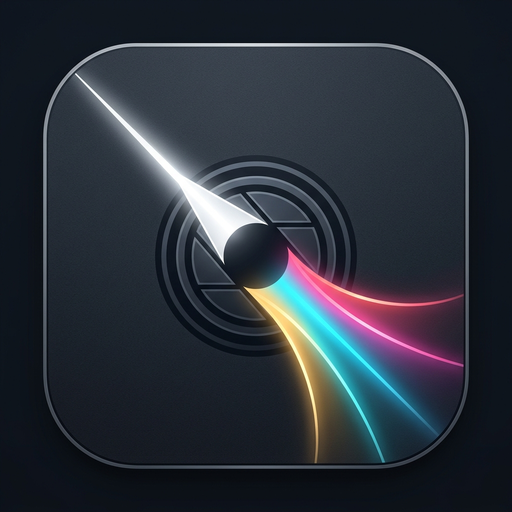

<p align="center">
  
</p>

<h1 align="center">beaM.</h1>

<p align="center">
  <strong>Modern ve Tahribatsız Masaüstü Fotoğraf Stüdyosu</strong><br />
  Linux ve Windows için profesyonel RAW fotoğraf düzenleme ve yerel arşiv yönetimi.
</p>

<p align="center">
  <a href="https://github.com/MOzcelik14/beaM/releases"></a>
  <a href="LICENSE"></a>
  
</p>

<p align="center">
  <a href="README.md">English</a> · <a href="README.tr.md">Türkçe</a>
</p>

---

## beaM. Dünyasına Hoş Geldiniz

**beaM.**; fotoğrafçılar, görsel tasarımcılar ve yaratıcı profesyoneller için geliştirilmiş, tam sanatsal denetim, yüksek renk doğruluğu ve mutlak veri gizliliği sunan bağımsız bir masaüstü fotoğraf uygulamasıdır.

Eski nesil hantal yazılımların getirdiği karmaşıklıkları, zorunlu abonelik ücretlerini ve gizlilik endişelerini ortadan kaldırmak amacıyla sıfırdan geliştirilen beaM., doğrudan bilgisayarınızda stüdyo kalitesinde bir karanlık oda deneyimi sunar. Orijinal kamera dosyalarınız diskte hiçbir zaman değiştirilmez, tüm ayarlar anlık olarak uygulanır ve arşiviniz tamamen kendi kontrolünüzde kalır.

---

## Neden beaM.?

- **Tam Veri Sahipliği ve Gizlilik**: Kullanıcı hesabı, telemetri veya zorunlu bulut eşitlemesi yoktur. Fotoğraflarınız, ayarlarınız ve hazır şablonlarınız yalnızca sizin diskinizde saklanır.
- **Tamamen Tahribatsız (Non-Destructive) İş Akışı**: Kadraj, ton eğrisi ve renk ayarlamalarının tamamı hafif ve okunabilir `.beam` yan dosyalarında kaydedilir. Orijinal RAW ve standart görsellerinizin üzerine asla yazılmaz.
- **Donanım Hızlandırmalı Akıcı Performans**: Kaydırıcıları hareket ettirirken veya yüksek çözünürlüklü fotoğrafları işlerken modern çok çekirdekli işlemciler ve grafik kartları sayesinde anında görsel geri bildirim alırsınız.
- **Stüdyo Seviyesinde Renk Doğruluğu**: Geniş renk uzayları ve endüstri standardı ICC profilleri (sRGB, Display P3, Adobe RGB) ile çalışarak ekranınızdaki sonucun baskıda ve dijital platformlarda birebir tutarlı olmasını sağlarsınız.

---

## Öne Çıkan Yetenekler

### Renk ve Ton Hassasiyeti
Işık ve gölgeyi profesyonel tonlama araçlarıyla şekillendirin:
- **Tonal Denge**: Geniş dinamik aralığa sahip kareler için hassas Pozlama, Kontrast, Parlak Alanlar ve Gölgeler denetimi.
- **Beyaz Dengesi**: Doğal ten renkleri ve doğru gün ışığı üretimi için ince Kelvin Sıcaklık ve Ton düzeltmeleri.
- **Parametrik Ton Eğrisi**: Parlak noktalar, orta tonlar ve derin gölgeler üzerinde pürüzsüz kontrol sağlayan etkileşimli ton eğrisi.
- **8 Bantlı HSL Renk Derecelendirme**: Sekiz ana renk kanalında (Kırmızı, Turuncu, Sarı, Yeşil, Açık Mavi, Mavi, Mor, Eflatun) bağımsız Renk Özü (Hue), Doygunluk (Saturation) ve Parlaklık (Lightness) yönetimi.

### Kadraj, Kırpma ve Geometri
Kompozisyonunuzu tam istediğiniz gibi kurgulayın:
- **En-Boy Oranı Şablonları**: 1:1, 4:5, 3:2, 16:9 oran kilitleri ve serbest kırpma desteği.
- **Kompozisyon Kılavuzları**: Dengeli kadrajlar için altın oran ve üçte birler kuralı ızgaraları.
- **Ufuk Düzeltme**: Kanvas sınırlarını otomatik koruyan akıcı rotasyon ve ufuk çizgisi hizalama.

### Gerçek Zamanlı İnceleme ve Karşılaştırma
Yaptığınız düzenlemeleri anında denetleyin:
- **Öncesi / Sonrası Modları**: Tam ekran öncesi/sonrası geçişi, sürüklenebilir bölünmüş görünüm ve yan yana karşılaştırma.
- **Pozlama Kırpılma Uyarıları**: Dışa aktarmadan önce patlayan parlak alanları ve kaybolan gölge detaylarını vurgulayan canlı uyarılar.
- **Dinamik Histogram**: Canlı RGB ve aydınlık dağılımını gösteren stüdyo seviyesi histogram.

### Zahmetsiz Yerel Fotoğraf Yönetimi
Fotoğraf arşivinizi hantal veritabanı kilitleri olmadan düzenleyin:
- **Doğrudan Klasör Tarayıcısı**: Uzun süren içe aktarma adımlarına gerek kalmadan diskteki klasörlerinize anında erişin.
- **Ayıklama ve Puanlama**: Yıldız puanları (1-5 yıldız), renk etiketleri ve hızlı klavye kısayolları.
- **Metadata İnceleme**: Kamera markası, lens modeli, enstantane, diyafram ve ISO gibi EXIF verilerini anında görüntüleyin.

### Yüksek Kaliteli Toplu Dışa Aktarım
Çalışmalarınızı baskıya veya dijital paylaşıma hazır hale getirin:
- **Esnek Formatlar**: Standart JPEG veya kayıpsız 8-bit/16-bit PNG çıktısı.
- **Renk Profili Yönetimi**: sRGB, Display P3 ve Adobe RGB profillerini dosyalara gömerek tutarlı renk üretimi.
- **Toplu İşleme ve Şablonlar**: Özelleştirilebilir dosya adı şablonlarıyla tüm albümü arka planda topluca dışa aktarma.

---

## Desteklenen Formatlar

beaM., popüler dijital kameraların RAW formatlarını ve standart görüntü dosyalarını doğrudan destekler:

| Kategori | Desteklenen Uzantılar |
| :--- | :--- |
| **Kamera RAW** | `.arw`, `.cr2`, `.cr3`, `.nef`, `.raf`, `.rw2`, `.dng`, `.pef`, `.orf` |
| **Standart Görseller** | `.jpg`, `.jpeg`, `.png`, `.tif`, `.tiff`, `.webp` |
| **Proje ve Düzenlemeler** | `.beam` (tahribatsız yan dosya ve bağımsız proje formatı) |

---

## İndirme ve Başlarken

### Kurulum Paketleri
İşletim sisteminize uygun hazır paketleri [GitHub Releases](https://github.com/MOzcelik14/beaM/releases) sayfasından edinebilirsiniz:

- **Debian / Ubuntu / Pop!_OS (`.deb`)**:
  ```bash
  sudo dpkg -i beam_1.0.0_amd64.deb
  sudo apt-get install -f
  ```
- **Fedora / RHEL / CentOS (`.rpm`)**:
  ```bash
  sudo rpm -i beam-1.0.0-1.x86_64.rpm
  ```
- **Evrensel Taşınabilir Linux (`.AppImage`)**:
  ```bash
  chmod +x beaM-1.0.0-x86_64.AppImage
  ./beaM-1.0.0-x86_64.AppImage
  ```
- **Windows 10 / 11 (64-bit)**:
  - **Kurulum**: Başlat menüsü ve dosya ilişkilendirmeleriyle kurulum için `beaM-v1.0.0-windows-x86_64-setup.exe` dosyasını çalıştırın.
  - **Taşınabilir**: `beaM-v1.0.0-windows-x86_64.zip` arşivini açıp doğrudan `beam.exe` dosyasını çalıştırın.

### prisM. Suite Entegrasyonu
Eğer [prisM. Suite](https://github.com/MOzcelik14/prism-suite) kullanıyorsanız, **beaM.** uygulamasını tek merkezden kolayca kurabilir, başlatabilir ve güncelleyebilirsiniz.

---

## Sistem Önerileri

| Bileşen | Minimum Gereksinim | Önerilen Donanım |
| :--- | :--- | :--- |
| **İşletim Sistemi** | Windows 10/11 (64-bit) veya Güncel Linux (glibc 2.31+) | Windows 11 (64-bit) veya Ubuntu 22.04+ / Fedora 38+ |
| **İşlemci** | 64-bit Çift Çekirdekli İşlemci | Modern Dört Çekirdekli / Çok Çekirdekli İşlemci |
| **Bellek (RAM)** | 4 GB RAM | 8 GB RAM veya üzeri |
| **Ekran Kartı** | Vulkan 1.2+ veya DirectX 12 destekli grafik birimi | 2 GB+ VRAM'e sahip harici ekran kartı |
| **Depolama** | Uygulama için 150 MB boş disk alanı | Yüksek çözünürlüklü RAW dosyalar için hızlı SSD / NVMe |

---

## Gizlilik ve Güvenlik İlkeleri

**beaM.** mutlak kullanıcı gizliliği temeli üzerine inşa edilmiştir:
- **Sıfır Telemetri**: Uygulama hiçbir zaman sunuculara veri göndermez, kişisel kullanım istatistiği toplamaz.
- **Tamamen Çevrimdışı Çalışma**: Tüm fonksiyonlar internet bağlantısına ihtiyaç duymadan eksiksiz çalışır.
- **Orijinal Dosya Güvenliği**: Düzenlemeler orijinal dosyalardan bağımsız saklanır, kaynak dosyaların bozulma riski kesinlikle yoktur.

---

## Geliştirici Bilgisi

<details>
<summary>Kaynaktan Derleme (İsteğe Bağlı)</summary>

beaM. uygulamasını kendi makinenizde derlemek isterseniz:

1. Rust derleyicisini kurun (Rust 1.89 veya üzeri önerilir):
   ```bash
   curl --proto '=https' --tlsv1.2 -sSf https://sh.rustup.rs | sh
   ```
2. Depoyu klonlayıp release profilinde derleyin:
   ```bash
   git clone https://github.com/MOzcelik14/beaM.git
   cd beaM
   cargo build --release -p beam-app
   ```
3. Çalıştırılabilir dosya `target/release/beam` konumunda oluşturulacaktır.

</details>

---

## Lisans ve Topluluk

**beaM.**, **GNU Genel Kamu Lisansı v3.0 (GPL-3.0)** şartları altında dağıtılan özgür ve açık kaynak kodlu bir yazılımdır. Detaylı bilgi için [LICENSE](LICENSE) dosyasına başvurabilirsiniz.

- **Hata Bildirimi ve İstekler**: Görüş ve önerilerinizi [GitHub Issues](https://github.com/MOzcelik14/beaM/issues) üzerinden paylaşabilirsiniz.
- **Kaynak Kod**: Projeyi incelemek ve katkıda bulunmak için: [https://github.com/MOzcelik14/beaM](https://github.com/MOzcelik14/beaM).
