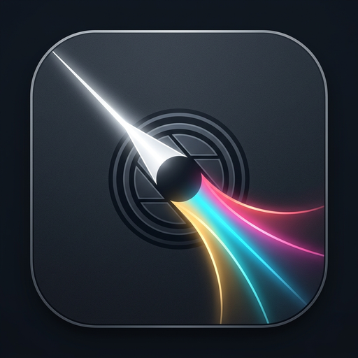

<p align="center">
  
</p>

<h1 align="center">beaM.</h1>

<p align="center">
  <strong>Profesyonel, Tahribatsız RAW Fotoğraf Düzenleyici ve Kütüphane Yöneticisi</strong><br>
  Saf Rust ile sıfırdan geliştirilmiş, wgpu ve egui ile güçlendirilmiş masaüstü yazılımı.
</p>

<p align="center">
  <a href="README.md"><strong>English</strong></a> | <a href="README.tr.md"><strong>Türkçe</strong></a>
</p>

<p align="center">
  <strong>Sürüm:</strong> 0.2.0 &nbsp;|&nbsp;
  <strong>Lisans:</strong> GNU Genel Kamu Lisansı v3.0 &nbsp;|&nbsp;
  <strong>Platformlar:</strong> Linux, Windows &nbsp;|&nbsp;
  <strong>Mimari:</strong> x86_64
</p>

---

## Genel Bakış

**beaM.**; fotoğrafçılar, görsel tasarımcılar ve renk uzmanları için geliştirilmiş, tam denetim, renk doğruluğu ve veri gizliliği sunan bağımsız ve yüksek performanslı bir masaüstü fotoğraf işleme uygulamasıdır.

Monolitik C/C++ çalışma zamanlarına veya bulut aboneliklerine bağımlı geleneksel ticari yazılımların aksine beaM., baştan sona Rust dili ile inşa edilmiştir. Donanım hızlandırmalı görüntü işleme için **WebGPU (wgpu)**, anlık tepki veren kullanıcı arayüzü için **egui** kütüphanesini kullanır.

beaM. içerisindeki tüm düzenlemeler mutlak surette tahribatsızdır (non-destructive): Orijinal çekim dosyaları disk üzerinde hiçbir zaman değiştirilmez; tüm düzenleme adımları hafif ve sürümlendirilebilir yan dosyalarda (sidecar) saklanır.

---

## Öne Çıkan Mühendislik Nitelikleri

### 1. Tahribatsız Yan Dosya (Sidecar) Mimarisi
Orijinal çekim verisi asla değiştirilmez. Tonal ayarlamalar, eğriler, kırpmalar ve metaveriler, insanlar tarafından okunabilir ve git ile diff alınabilir [RON](https://github.com/ron-rs/ron) biçimindeki yan dosyalara (`<dosya_adi>.beam` veya bağımsız `.beam` proje paketleri) kaydedilir. Dosyalarınızı taşısanız veya yedekleseniz dahi düzenleme geçmişiniz ve ham fotoğraf veriniz birbirinden bağımsız biçimde korunur.

### 2. Doğrusal Rec.2020 Çalışma Renk Uzayı
Dijital sensörler, sahne parlaklığı ile doğrusal ilişkiye sahip fiziksel foton sayılarını kaydeder. beaM., tüm dahili pozlama, kromatik uyarlama ve ton dönüşümlerini **Doğrusal Rec.2020 (ITU-R BT.2020)** uzayında gerçekleştirir:
- **Pozlama ölçekleme**, fiziksel foton miktarını ikiye katlama işlemini ($I' = I \cdot 2^{\text{EV}}$) kırpılma bozulmaları olmadan gerçekleştirir.
- **Orta ton kontrastı**, %18 orta gri ($M = 0.18$) ekseninde üstel bir eğim fonksiyonuyla hesaplanır:
  $$x' = M \cdot \left(\frac{x}{M}\right)^{2^{C / 100}}$$
- **Beyaz dengesi**, Kelvin sıcaklığı ve Yeşil-Macenta renk tonu parametrelerinden türetilen kromatik uyarlama katsayılarını doğrudan doğrusal kanal genliklerine uygular.
- Ekranda gösterim veya dosyaya aktarım öncesinde değerler, standart gömülü ICC profili üretimiyle birlikte hedef renk uzaylarına (sRGB, Display P3 veya Adobe RGB 1998) dönüştürülür.

### 3. Donanım Hızlandırmalı wgpu İşleme Hattı
Tüm ayarlamalar, GPU üzerinde 32-bit kayan noktalı ara dokular (`Rgba32Float`) arasında bağımsız WGSL gölgelendirici geçişleri olarak çalıştırılır. Kaydırıcı hareketleri bellek içi GPU vekil dokusu üzerinde işlenir; böylece monitörün doğal yenileme hızında milisaniyenin altında akıcı bir deneyim elde edilir.

### 4. Dikişsiz Parçalı (Tiled) Dışa Aktarma
Çok yüksek çözünürlüklü fotoğrafların (40 MP, 60 MP, 100+ MP) dışa aktarımı, klasik yazılımlarda bellek taşması ve çökme sorunlarına yol açabilir. beaM., 2048 pikseli aşan görüntüleri otomatik olarak bağımsız bloklara bölen dikişsiz bir parçalı dışa aktarma alt sistemine sahiptir. Parçalama işlemi piksel sınırlarında hiçbir dikiş izi bırakmaz ve çıktı çözünürlüğü ne olursa olsun GPU bellek kullanımını 70 MB'ın altında tutar.

### 5. Baştan Sona Saf Rust Medya Yığını
beaM., LibRaw, libpng veya LibTIFF gibi eski C/C++ kütüphanelerine olan bağımlılıkları tamamen ortadan kaldırır. Kamera RAW kod çözümü ve mozaiksizleştirme doğrudan `rawler` ile sağlanır. Standart piksel formatları (JPEG, PNG, TIFF, WebP) saf Rust kütüphaneleriyle açılır, ICC profil dönüşümleri `moxcms` ile yürütülür ve EXIF metaverileri `kamadak-exif` ile ayrıştırılır.

### 6. Yerel SQLite Fotoğraf Kataloğu
Kütüphane yönetimi, gömülü ve ACID uyumlu bir SQLite kataloğu (`beam-library`) üzerinden sağlanır. Fotoğraf dizinlerini tarar, yıldız puanlamalarını (0–5), renk etiketlerini ve kamera metaverilerini dizinler; arka plan iş parçacıkları üzerinden iş parçacığı güvenli küçük resim önbelleği oluşturur.

---

## Uygulama Modülleri

### Geliştir (Develop) Modülü
- **Temel Tonlar**: Pozlama (-5.0 ile +5.0 EV), Kontrast (-100 ile +100), Işıklar, Gölgeler.
- **Renk Dengesi**: Sıcaklık (2000K ile 12000K), Renk Tonu / Tint (-100 ile +100).
- **Ton Eğrisi**: Parametrik ve nokta eğri düzenlemelerini destekleyen etkileşimli spline aracı.
- **8 Bant HSL**: Kırmızı, Turuncu, Sarı, Yeşil, Açık Mavi, Mavi, Mor ve Macenta bantları için bağımsız Renk Tonu (Hue), Doygunluk (Saturation) ve Parlaklık (Luminance) ayarları.
- **Kırpma ve Geometri**: Serbest ve sabit en-boy oranlı kırpma (1:1, 4:5, 3:2, 16:9), 90 derece döndürme, yatay/dikey çevirme ve yüksek hassasiyetli sürekli doğrultma kaydırıcısı (-45.0° ile +45.0°).
- **Karşılaştırma Modları**:
  - *Geçiş (`\`)*: İşlenmiş görüntü ile orijinal vekil doku arasında tek tuşla anında geçiş.
  - *Bölünmüş Ekran*: Tek bir pencere içinde sürüklenebilir ayırıcı çubukla öncesi/sonrası karşılaştırması.
  - *Yan Yana*: Eşzamanlı yakınlaştırma ve kaydırma destekli ikili inceleme görünümü.
- **Detaylı İnceleme**: Canlı RGB ve parlaklık histogramı, patlayan açık tonlar ve tıkanan koyu tonlar için kırpılma uyarı katmanları (`J`).
- **Geçmiş ve Hazır Ayarlar**: İstenilen adıma tek tıkla dönülebilen 50 adımlı doğrusal geri alma/yineleme geçmişi, yeniden kullanılabilir kullanıcı önayarları ve fotoğraflar arası ayar senkronizasyonu.

### Kütüphane (Library) Modülü
- **Dosya Yöneticisi ve Dizin Tarama**: RawTherapee tarzı yerleşik dosya gezgini, hızlı Konumlar, kalıcı yer imleri, alt klasör gezinimi, isteğe bağlı özyinelemeli tarama ve sembolik bağ döngüsü koruması.
- **Metaveri İncelemesi**: Lens, odak uzaklığı, ISO, enstantane hızı, diyafram ve kamera gövdesi gösterimi.
- **Filtreleme ve Arama**: Yıldız puanı, renk etiketi, dosya uzantısı veya metin sorgusuna göre filtreleme.
- **Film Şeridi (Filmstrip)**: Geliştir modunda fotoğraflar arasında hızlı geçiş sağlayan açılır-kapanır alt şerit.

### Dışa Aktarma (Export) Alt Sistemi
- **Desteklenen Biçimler**: 8-bit JPEG (1–100 arası ayarlanabilir kalite) ve 8/16-bit PNG.
- **Renk Profilleri**: Gömülü ICC profilleriyle sRGB, Display P3 ve Adobe RGB (1998).
- **Boyutlandırma ve Keskinleştirme**: Yüksek kaliteli Lanczos3 ölçekleme (orijinal, uzun kenar, yüzde, kesin piksel boyutları) ve ekran veya baskı için ayarlanabilir maskeleme ile keskinleştirme (unsharp mask).
- **Toplu İşleme**: Canlı ilerleme takibi, iptal desteği ve dinamik dosya adı şablonları (`{name}`, `{date}`, `{rating}`, `{counter}`) sunan arka plan dışa aktarıcısı.

---

## Desteklenen Dosya Biçimleri

| Kategori | Biçimler ve Uzantılar | Bit Derinliği ve Yetenekler |
| :--- | :--- | :--- |
| **Kamera RAW** | `.arw`, `.cr2`, `.cr3`, `.nef`, `.raf`, `.rw2`, `.dng`, `.pef`, `.orf` | Saf Rust ile doğrudan kod çözümü, mozaiksizleştirme, doğrusal sensör yanıtı |
| **Standart Piksel** | JPEG (`.jpg`, `.jpeg`), PNG (`.png`), TIFF (`.tif`, `.tiff`), WebP (`.webp`) | 8-bit ve 16-bit kanal derinliği koruması, gömülü ICC profili dönüşümleri |
| **Yan Dosyalar ve Projeler** | `.beam`, `.beam.ron` | Okunabilir RON biçimi, kayıpsız sürüm göçü, geriye dönük uyumluluk |

---

## Sistem Gereksinimleri

- **İşletim Sistemi**: Linux (glibc 2.31+, modern masaüstü ortamı) veya Windows 10/11 (64-bit).
- **Grafik Donanımı**: Vulkan 1.2+ (Linux/Windows) veya DirectX 12 (Windows) destekli ekran kartı.
  - *Linux*: Mesa Vulkan sürücüleri (`mesa-vulkan-drivers`) veya tescilli Nvidia sürücüleri (525+).
  - *Windows*: Güncel Intel, AMD veya Nvidia grafik sürücüleri.
- **Bellek**: En az 4 GB RAM (Büyük toplu dışa aktarmalar için 8 GB tavsiye edilir).
- **Depolama**: Uygulama ikili dosyası için yaklaşık 50 MB boş alan.

---

## Kurulum ve Hızlı Başlangıç

### Dağıtım Paketleri ve Hazır İkililer
İşletim sisteminize uygun derlenmiş son sürüm dağıtım paketlerini [GitHub Sürümleri](https://github.com/MOzcelik14/beaM/releases) sayfasından edinebilirsiniz:

- **Debian / Ubuntu / Pop!_OS (`.deb`)**:
  ```bash
  sudo dpkg -i beam_0.2.0_amd64.deb
  sudo apt-get install -f  # eksik bağımlılıkları tamamlamak için
  ```
- **Fedora / RHEL / Rocky Linux (`.rpm`)**:
  ```bash
  sudo rpm -i beam-0.2.0-1.x86_64.rpm
  ```
- **Evrensel Taşınabilir Linux (`.AppImage`)**:
  ```bash
  chmod +x beaM-0.2.0-x86_64.AppImage
  ./beaM-0.2.0-x86_64.AppImage
  ```
- **Windows Kurulum (`.exe`) ve Taşınabilir (`.zip`)**:
  - Başlat menüsü kısayolları ve `.beam`/RAW dosya ilişkilendirmeleriyle tam kurulum için `beaM-v0.2.0-windows-x86_64-setup.exe` çalıştırın.
  - Veya `beaM-v0.2.0-windows-x86_64.zip` arşivini açıp doğrudan `beam.exe` dosyasını çalıştırın.

### Kaynaktan Paket Oluşturma
`packaging/` dizinindeki birleşik betiklerle tüm dağıtım paketlerini yerel ortamınızda oluşturabilirsiniz:
- **Linux (`.deb`, `.rpm`, `.AppImage`, `.tar.gz`)**:
  ```bash
  ./packaging/linux/build-linux.sh
  ```
- **Windows (Taşınabilir `.zip` ve Inno Setup `.exe`)**:
  ```powershell
  .\packaging\windows\build-windows.ps1
  ```

### Kaynak Koddan Derleme

Sisteminizde güncel bir Rust derleyicisinin kurulu olduğundan emin olun (Rust 1.89+ tavsiye edilir, 2021 sürümü):

```bash
# Depoyu klonlayın
git clone https://github.com/MOzcelik14/beaM.git
cd beaM

# Optimize edilmiş ikili dosyayı derleyin
cargo build --release

# Uygulamayı başlatın
./target/release/beam
```

Doğrudan bir fotoğrafı açmak için dosya yolunu argüman olarak verebilirsiniz:
```bash
./target/release/beam /ornek/fotograf.ARW
```

### Test ve Kod Kalitesi
Kod tabanı kapsamlı birim, özellik (property) ve entegrasyon testleri ile doğrulanmıştır:

```bash
# Tüm çalışma alanı testlerini çalıştırın
cargo test --workspace

# Kod biçimlendirme ve linter kurallarını denetleyin
cargo fmt --check
cargo clippy --workspace --all-targets -- -D warnings
```

---

## Klavye Kısayolları

| Kısayol | Kapsam | Eylem |
| :--- | :--- | :--- |
| `G` | Genel | Kütüphane Izgara Görünümüne Geç |
| `D` | Genel | Geliştir (Develop) Görünümüne Geç |
| `Ctrl + O` | Genel | Fotoğraf Dosyası Aç |
| `Ctrl + Shift + O` | Genel | Klasörü Kütüphaneye Aktar |
| `Ctrl + S` | Geliştir | Değişiklikleri Kaydet (Yan Dosya / Proje) |
| `Ctrl + Shift + S` | Geliştir | Projeyi Farklı Kaydet... |
| `Ctrl + W` | Geliştir | Projeyi Kapat (Değişiklik Varsa Onay Penceresi ile) |
| `Ctrl + E` | Genel | Dışa Aktarma Penceresini Aç |
| `Ctrl + Z` | Geliştir | Son İşlemi Geri Al |
| `Ctrl + Shift + Z` / `Ctrl + Y` | Geliştir | İşlemi Yinele |
| `\` | Geliştir | Öncesi / Sonrası Görünümünü Aç/Kapat |
| `C` | Geliştir | Kırpma Aracını Başlat / Bitir |
| `J` | Geliştir | Kırpılma (Clipping) Uyarı Katmanlarını Aç/Kapat |
| `Z` | Geliştir | Ekrana Sığdır / %100 (1:1) Birebir Yakınlaştır |
| `F` / `F11` | Genel | Tam Ekran Modu |
| `0` – `5` | Genel | Fotoğrafa Yıldız Puanı Ver (0 ile 5 yıldız) |
| `6` – `9` | Genel | Renk Etiketi Ata (Kırmızı, Sarı, Yeşil, Mavi) |
| `Sol` / `Sağ` Ok | Genel | Önceki / Sonraki Fotoğrafa Geç |
| `Ctrl + ,` | Genel | Uygulama Ayarlarını Aç |

---

## Mimari Yapı

```
beaM/
├── Cargo.toml                # Ortak bağımlılıkları tanımlayan çalışma alanı bildirimi
├── crates/
│   ├── beam-app/             # Masaüstü uygulaması kabuğu, egui arayüzü, olay döngüsü
│   ├── beam-core/            # Düzenleme modelleri, doğrusal Rec.2020 renk matematiği, i18n
│   ├── beam-gpu/             # wgpu bağlamı, işleme hattı, WGSL gölgelendirici geçişleri
│   ├── beam-media/           # RAW kod çözümü, piksel biçimleri, parçalı dışa aktarma, EXIF/ICC
│   └── beam-library/         # SQLite fotoğraf kataloğu, metaveri dizinleme, küçük resim servisi
├── locales/                  # Mozilla Project Fluent çeviri dosyaları (en.ftl, tr.ftl)
├── shaders/                  # Donanım hızlandırmalı WGSL gölgelendiricileri
└── docs/                     # Belgeler ve resmi GitHub Pages web sitesi
```

---

## Çoklu Dil Desteği

beaM., Mozilla Project Fluent (`fluent-bundle`) altyapısı sayesinde **Türkçe** ve **İngilizce** dillerini eksiksiz olarak destekler. Dil tercihi Ayarlar penceresinden (`Ctrl+,`) anlık olarak değiştirilebilir ve arayüz yeniden başlatmaya gerek kalmadan güncellenir. Çeviri kataloglarının anahtar eşitliği derleme anında otomatik testlerle denetlenir.

Yeni bir dil katkısında bulunmak için [crates/beam-core/src/i18n.rs](crates/beam-core/src/i18n.rs) içerisindeki belgelendirmeyi inceleyebilirsiniz.

---

## Güvenlik ve Dayanıklılık

beaM., kapsamlı bir güvenlik ve dayanıklılık denetiminden geçirilmiştir. Öne çıkan güvenlik özellikleri:
- Uygulama kodunda sıfır `unsafe` bloğu ve sıfır bellek transmutation kullanımı.
- RAW ve standart görüntü kod çözücülerinde, EXIF bloklarında ve ICC profili ayrıştırıcılarında 10 dakikalık sürekli fuzzing denetimi.
- Dışa aktarma ve dosya kaydetme süreçlerinde dizin aşma (path traversal) açıklarına karşı katı yol doğrulaması.
- Sıkıştırma bombalarına (decompression bombs), döngüsel sembolik bağlara ve bozuk dosya yapılarına karşı önleyici denetimler.

Ayrıntılı denetim kayıtları ve test ölçümleri için [SECURITY_AUDIT.md](SECURITY_AUDIT.md) belgesini inceleyebilirsiniz.

---

## Lisans

beaM., **GNU Genel Kamu Lisansı v3.0 (GPL-3.0-only)** koşulları altında dağıtılan özgür ve açık kaynak kodlu bir yazılımdır. Ayrıntılar için [LICENSE](LICENSE) dosyasına bakabilirsiniz.
