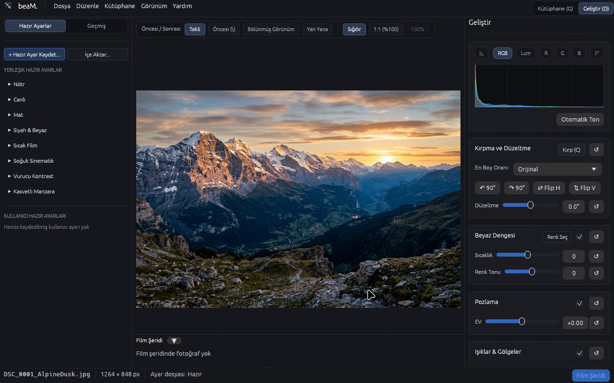
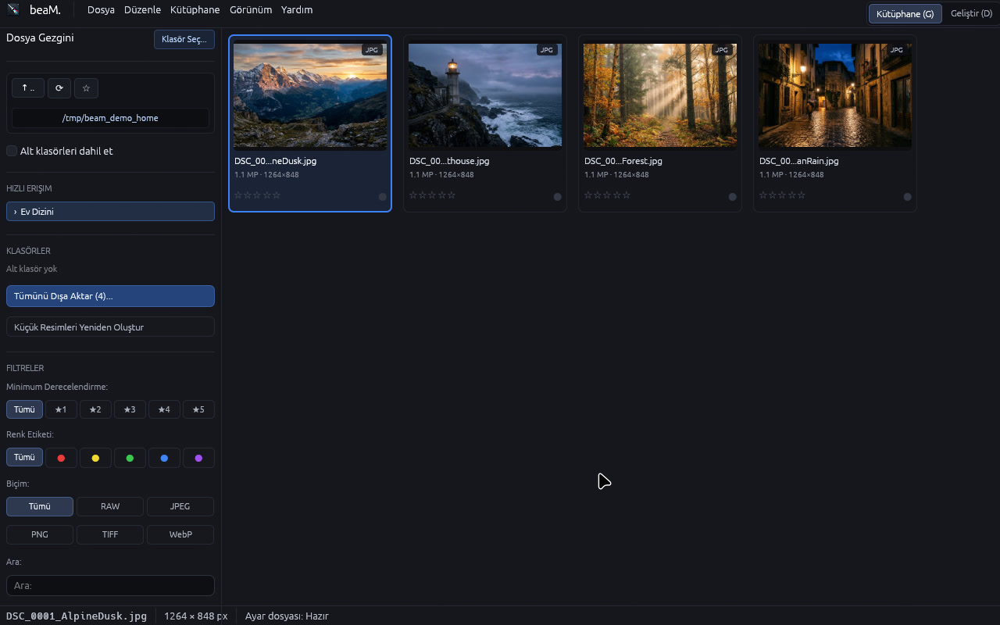
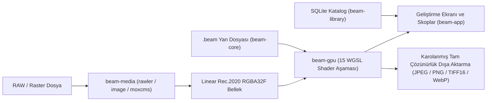

<p align="right">
  <a href="README.md">English</a> | <strong>Türkçe</strong>
</p>

<div align="center">

<h1>beaM.</h1>

<p>Rust ile geliştirilmiş, tahribatsız RAW fotoğraf geliştirme ve yerel kütüphane yönetimi uygulaması.</p>

<p>
  <a href="LICENSE"></a>
  <a href="https://github.com/MOzcelik14/beaM/releases"></a>
  <a href="https://www.rust-lang.org/"></a>
  <a href="#sistem-gereksinimleri"></a>
  <a href="https://github.com/MOzcelik14/beaM/actions/workflows/release.yml"></a>
  <a href="https://github.com/MOzcelik14/beaM/commits/master"></a>
  <a href="https://github.com/MOzcelik14/prism-suite"></a>
</p>

<p>
  <a href="#genel-bakış">Genel Bakış</a> |
  <a href="#özellikler">Özellikler</a> |
  <a href="#kurulum">Kurulum</a> |
  <a href="#başlangıç">Başlangıç</a> |
  <a href="#klavye-kısayolları">Kısayollar</a> |
  <a href="#desteklenen-formatlar">Formatlar</a> |
  <a href="#mimari">Mimari</a> |
  <a href="#geliştirme">Geliştirme</a>
</p>

<p>
  
</p>

</div>

---

## Genel Bakış

**beaM.**, öngörülebilir renk işleme, hızlı yerel tarama ve dosyaları üzerinde tam denetim isteyen fotoğrafçılar için tasarlanmış masaüstü RAW fotoğraf geliştirme ve yerel katalog yönetimi uygulamasıdır. Uygulama tamamen çevrimdışı çalışır; hesap, telemetri veya bulut bağımlılığı gerektirmez.

Tüm düzenlemeler tahribatsızdır. Kamera asılları ve raster görüntüler hiçbir zaman değiştirilmez; ayarlar, düzenleme geçmişi, adlandırılmış anlık görüntüler (snapshot), yıldız derecelendirmeleri ve renk etiketleri fotoğrafların yanında okunabilir `.beam` yan (sidecar) dosyalarında saklanır. Yerel SQLite kataloğu ise klasör yapınızı bozmadan dizinleri, meta verileri, etiketleri, akıllı koleksiyonları ve küçük resimleri dizinler.

Görüntü işleme hattı tamamen Rust ile yazılmıştır. RAW dosyaları harici yerel RAW kütüphanelerine ihtiyaç duymadan saf Rust tabanlı `rawler` üzerinden çözülür, geniş renk gamlı doğrusal çalışma uzayına (Linear Rec.2020, kanal başına 32-bit kayan noktalı) dönüştürülür ve `wgpu` aracılığıyla modüler WGSL gölgelendiricileri (shader) ile GPU üzerinde işlenir. Etkileşimli düzenleme sırasında akıcı sürgü tepkisi için en fazla 1920 px boyutunda bir vekil (proxy) bellek kullanılırken, 1:1 yakınlaştırma ve dışa aktarma işlemleri tam çözünürlükte ve yüksek megapikselli görüntüler için otomatik karolama (tiled rendering) ile gerçekleştirilir.

## Öne Çıkanlar

- **Saf Rust RAW Çözümleme**: Harici `libraw` bağımlılığı olmadan `rawler` ile doğrudan kamera RAW dosyalarını okur; dosya boyutu, çözünürlük ve bellek sınırları ile güvenli çözümleme sunar. JPEG, PNG, TIFF ve WebP için tam hassasiyetli raster desteği içerir.
- **Geniş Gamlı GPU İşleme Hattı**: Düzenlemeleri `wgpu` üzerinde 32-bit kayan noktalı Linear Rec.2020 uzayında modüler WGSL aşamalarıyla işler; büyük görüntülerde otomatik karolama uygular.
- **Tahribatsız Yan Dosyalar**: Tüm düzenleme yığınını, geri alma geçmişini, anlık görüntüleri, yıldızları ve renk etiketlerini atomik yazımla okunabilir `.beam` RON dosyalarında tutar.
- **Eksiksiz Yerel Katalog**: SQLite dizinleme, sanal kopyalar, yıldız ve renk etiketleri, çoklu etiketleme, akıllı koleksiyonlar, IPTC/XMP meta veri düzenleme, kopya tespiti ve klasör izleme (Tethered Watch) sunar.
- **Renk Yönetimli Çıktı**: Gam dışı uyarılı yumuşak prova (Soft Proofing), canlı skoplar (Histogram, Waveform, RGB Parade, Vectorscope) ve gömülü ICC profilli JPEG, PNG, 16-bit TIFF ve WebP dışa aktarma sağlar.

## Özellikler

### Ton, Renk ve Detay

| Özellik | Ayrıntılar |
| :--- | :--- |
| Beyaz Dengesi | Doğrusal uzayda Sıcaklık (-100 ile +100) ve Ton (-100 ile +100) ayarı. |
| Pozlama ve Ton | Pozlama (-5.0 ile +5.0 EV), Kontrast (-100 ile +100), Açık Tonlar, Gölgeler, Beyazlar ve Siyahlar (-100 ile +100). |
| Ton Eğrisi | Bağımsız Ana, Kırmızı, Yeşil ve Mavi kanallarına sahip etkileşimli kübik-spline ton eğrisi. |
| 8 Bantlı HSL | Kırmızı, Turuncu, Sarı, Yeşil, Deniz Mavisi, Mavi, Mor ve Macenta için bağımsız Ton, Doygunluk ve Parlaklık sürgüleri. |
| Canlılık ve Doygunluk | Seçici canlılık (Vibrance) ve genel doygunluk (-100 ile +100). |
| 3 Yollu Renk Derecelendirme | Gölgeler, Orta Tonlar ve Açık Tonlar için renk tekerlekleri; Ton, Doygunluk, Parlaklık, Denge ve Harmanlama kontrolleri. |
| Kamera Profilleri | Yerleşik Standard, Neutral, Vivid, Portrait, Landscape ve Monochrome işleme profilleri. |
| Detay ve Gürültü Azaltma | Netlik (Clarity), Pus Giderme (Dehaze), Kenar Keskinleştirme, Parlaklık/Renk Gürültü Azaltma ve yerel 5x5 kenar koruyucu Akıllı Gürültü Azaltma (Smart Denoise). |
| 3D LUT Desteği | Ayarlanabilir karışım yoğunluğu (%0 - %100) ile `.cube` 3D LUT dosyalarını yükler. |
| Vinyet ve Film Greni | Kırpma sonrası vinyet (miktar, orta nokta, yumuşatma) ve prosedürel film greni (miktar, tanecik boyutu). |

### Yerel Ayarlar ve Optik

| Özellik | Ayrıntılar |
| :--- | :--- |
| Maske Şekilleri | Doğrusal Degrade, Radyal Degrade (yumuşatma ve ters çevirme) ve Fırça darbeleri (yarıçap, yumuşatma ve ters çevirme). |
| Aralık Kısıtlamaları | Parlaklık aralığı maskeleme (alt sınır, üst sınır, geçiş yumuşaklığı) ve Renk Aralığı (hedef ton ve tolerans) filtreleme. |
| Otomatik Seçim Maskeleri | Doğrudan RGBA32F görüntü belleği üzerinde çalışan yerel sezgisel Otomatik Gökyüzü ve Otomatik Konu maskesi üretimi. |
| Maske Başına Kontroller | Her maske katmanı için bağımsız Pozlama, Kontrast, Açık Tonlar, Gölgeler, Sıcaklık, Ton ve Doygunluk. |
| Lens ve Perspektif | Fıçı/yastık bozulması, Kırmızı/Camgöbeği ve Mavi/Sarı yanal kromatik sapma, optik vinyet ve dikey/yatay perspektif (keystone) düzeltmesi. |
| Kırpma ve Geometri | Orijinal, 1:1, 4:5, 3:2, 16:9 ve Serbest en-boy oranları; 90 derece döndürme, yatay/dikey çevirme ve -45 ile +45 derece ufuk düzeltme. |

### İnceleme, Prova ve İş Akışı

| Özellik | Ayrıntılar |
| :--- | :--- |
| Canlı Skoplar | RGB, Parlaklık, Kırmızı, Yeşil ve Mavi histogramların yanında Waveform, RGB Parade ve Vectorscope görünümleri. |
| Öncesi ve Sonrası | Tam kare geçiş, sürüklenebilir bölünmüş görünüm ve yan yana karşılaştırma modları. |
| Tanısal Katmanlar | Açık ton ve gölge kırpılma uyarıları, Gam Dışı uyarılı Yumuşak Prova (Soft Proofing) ve Odak Vurgulama (Focus Peaking). |
| Ön Ayarlar ve Kopyala/Yapıştır | 8 yerleşik ön ayar, RON biçiminde özel kullanıcı ön ayarları ve fotoğraflar arasında seçici ayar grubu Kopyala/Yapıştır. |
| Geçmiş ve Anlık Görüntüler | Adım adım geri alma/yineleme geçmişi ve `.beam` yan dosyasında kalıcı adlandırılmış anlık görüntüler. |
| CLI Eklentileri | Kullanıcı eklenti dizinindeki `.ron` manifest dosyaları üzerinden harici CLI eklentilerini keşfetme ve çalıştırma (Filtre, Dışa Aktarma, Analiz kategorileri). |

### Kütüphane ve Varlık Yönetimi

| Özellik | Ayrıntılar |
| :--- | :--- |
| Klasör Tarama ve Katalog | Alt klasörlü veya tek düzeyli tarama, yer imi klasörleri, küçük resim önbelleği ve taşınan dosyaları yeniden bağlama destekli SQLite katalog. |
| Seçme ve Filtreleme | 0-5 yıldız derecelendirme, renk etiketleri (Kırmızı, Sarı, Yeşil, Mavi, Mor), dosya türü filtreleri (Tümü, RAW, JPEG, PNG, TIFF, WebP), metin arama ve sıralama (Tarih, Derece, Dosya Adı). |
| Etiketler ve Akıllı Koleksiyonlar | Çoklu fotoğraf etiketleme, etikete göre filtreleme ve tekrar kullanılabilir filtre birleşimlerini saklayan Akıllı Koleksiyonlar. |
| Sanal Kopyalar | Kaynak dosyayı çoğaltmadan aynı fotoğrafa bağlı birden fazla bağımsız `.beam` düzenleme yığını. |
| Meta Veri ve GPS | EXIF okuma (kamera, lens, ISO, enstantane, diyafram, odak uzaklığı), düzenlenebilir IPTC/XMP alanları (başlık, açıklama, oluşturan, telif) ve harita bağlantılı GPS koordinat kaydı. |
| Kopya Tespiti ve Kablolu İzleme | Kütüphane içi yinelenen fotoğraf tespiti ve yeni gelen çekimleri otomatik içe aktaran klasör izleme (Tethered Watch). |

### Dışa Aktarma Hattı

| Özellik | Ayrıntılar |
| :--- | :--- |
| Çıktı Formatları | JPEG (ayarlanabilir kalite), 8-bit PNG, 16-bit TIFF (`Tiff16`) ve WebP. |
| Renk Yönetimi | `moxcms` üzerinden sRGB, Display P3 ve Adobe RGB (1998) dönüşümü ve ICC profili gömme. |
| Yeniden Boyutlandırma ve Keskinleştirme | Orijinal boyut, Uzun Kenar, Yüzde veya Tam boyut (isteğe bağlı oran kilidi) ile Yok, Ekran veya Baskı çıktı keskinleştirmesi. |
| Toplu Dışa Aktarma ve Şablonlar | İptal edilebilir arka plan toplu dışa aktarma, EXIF yönlendirme normalleştirme, atomik dosya yazımı ve güvenli dosya adı şablonları (`{name}`, `{date}`, `{counter}`, `{rating}`). |

## Ekran Görüntüleri

| Geliştirme Çalışma Alanı | Kütüphane Kataloğu |
| :---: | :---: |
|  |  |

## Kurulum

### Hazır Paketler (GitHub Releases)

64-bit Linux (`x86_64`) ve Windows (`x86_64`) için önceden derlenmiş paketler, kurucular ve `SHA256SUMS.txt` doğrulama özetleri [GitHub Releases](https://github.com/MOzcelik14/beaM/releases) sayfasında yayınlanır.

#### Debian / Ubuntu (`.deb`)

```bash
sudo dpkg -i beam_1.2.6_amd64.deb
sudo apt-get install -f
```

#### Fedora / RHEL / openSUSE (`.rpm`)

```bash
sudo rpm -i beam-1.2.6-1.x86_64.rpm
```

#### Evrensel Taşınabilir Linux (`.AppImage`)

```bash
chmod +x beaM-1.2.6-x86_64.AppImage
./beaM-1.2.6-x86_64.AppImage
```

#### Taşınabilir Linux Arşivi (`.tar.gz`)

```bash
tar -xzf beam-v1.2.6-linux-x86_64.tar.gz
./beam-v1.2.6-linux-x86_64/beam
```

#### Windows (64-bit)

- **Kurucu (Installer)**: `beaM-v1.2.6-windows-x86_64-setup.exe` dosyasını indirip çalıştırın. Başlat Menüsü kısayolu, masaüstü simgesi, `.beam` proje ilişkilendirmesi ve kamera RAW dosya ilişkilendirmesi seçenekleri içerir.
- **Taşınabilir (Portable)**: `beaM-v1.2.6-windows-x86_64.zip` arşivini açıp `beam.exe` dosyasını doğrudan çalıştırın.

### Kaynaktan Derleme

#### Ön Koşullar

- Rust araç zinciri (stable, Rust 2021 edition; [rustup](https://rustup.rs/) ile kurulabilir).
- Vulkan (Linux/Windows) veya DirectX 12 (Windows) destekli GPU sürücüsü.
- Standart C/sistem derleme araçları (Linux'ta `gcc` veya `clang`, `pkg-config` ve Wayland/X11 geliştirme başlıkları). SQLite `rusqlite` ile gömülü geldiğinden ve RAW çözümleme saf Rust olduğundan harici `libsqlite3` veya `libraw` başlıklarına gerek yoktur.

#### Derleme ve Çalıştırma

```bash
git clone https://github.com/MOzcelik14/beaM.git
cd beaM
cargo build --release -p beam-app
./target/release/beam
```

Komut satırından doğrudan bir fotoğraf veya `.beam` proje dosyası da açabilirsiniz:

```bash
./target/release/beam /dosya/yolu/fotograf.ARW
```

## Başlangıç

1. **beaM. uygulamasını başlatın.** Sistem uygulama menüsünden açın veya terminalden `beam` komutunu çalıştırın.
2. **Bir Klasör İçe Aktarın.** `Ctrl+Shift+O` tuşlarına basın (veya Kütüphane görünümünde **Klasör İçe Aktar** düğmesine tıklayın) ve RAW ya da raster fotoğraflarınızın bulunduğu dizini seçin. beaM. dosyalarınızı taşımadan veya değiştirmeden yerel SQLite kataloğuna dizinler ve küçük resimleri önbelleğe alır.
3. **Seçin ve Düzenleyin.** Kütüphane görünümünde (`G`) ızgarada gezinin. Yıldız derecesi vermek için `0`-`5`, renk etiketi için `6`-`9` tuşlarını; derece, renk, format, etiket veya Akıllı Koleksiyon filtrelemesi için sol kenar çubuğunu kullanın.
4. **Geliştirme Görünümüne Geçin.** Bir fotoğrafa çift tıklayın veya `D` tuşuna basın.
5. **Tahribatsız Ayarları Uygulayın.** Sağ panelden Beyaz Dengesi, Pozlama, Ton Eğrisi, HSL, Renk Derecelendirme, Detay, Lens Düzeltme veya Yerel Maskeleri düzenleyin. `\` ile Öncesi/Sonrası karşılaştırması yapın, `J` ile kırpılma uyarılarını açın.
6. **Yan Dosyayı Kaydedin.** `Ctrl+S` ile düzenleme yığınını, geçmişi ve anlık görüntüleri eşlik eden `.beam` dosyasına kaydedin.
7. **Dışa Aktarın.** `Ctrl+E` ile Dışa Aktarma penceresini açın; çıktı formatını (JPEG, PNG, 16-bit TIFF veya WebP), renk uzayını, boyutlandırma modunu ve dosya adı şablonunu seçerek dışa aktarın.

## Klavye Kısayolları

Kısayollar **Ayarlar** (`Ctrl+,`) ekranından yapılandırılabilir. Metin giriş alanlarına yazarken tek tuşlu kısayollar otomatik olarak devre dışı bırakılır.

| Kısayol | İşlev | Bağlam |
| :--- | :--- | :--- |
| `Ctrl+O` | Fotoğraf veya `.beam` proje dosyası aç | Genel |
| `Ctrl+Shift+O` | Kütüphaneye klasör içe aktar | Genel |
| `Ctrl+S` | Etkin `.beam` yan dosyasını / projeyi kaydet | Genel |
| `Ctrl+Shift+S` | Projeyi farklı kaydet | Genel |
| `Ctrl+W` | Etkin projeyi kapat | Genel |
| `Ctrl+E` | Dışa Aktarma penceresini aç | Genel |
| `Ctrl+,` | Ayarları aç | Genel |
| `Ctrl+Z` | Son işlemi geri al | Genel |
| `Ctrl+Shift+Z` / `Ctrl+Y` | İşlemi yinele | Genel |
| `G` | Kütüphane (Izgara) görünümüne geç | Genel |
| `D` | Geliştirme görünümüne geç | Genel |
| `F` / `F11` | Tam ekran modunu aç/kapat | Genel |
| `\` | Öncesi / Sonrası karşılaştırmasını değiştir | Genel |
| `Sol Ok` / `PageUp` | Önceki fotoğraf | Genel |
| `Sağ Ok` / `PageDown` | Sonraki fotoğraf | Genel |
| `0` - `5` | Yıldız derecesi ata (0 dereceyi temizler) | Genel / Kütüphane |
| `6` / `7` / `8` / `9` | Renk etiketi ata (Kırmızı / Sarı / Yeşil / Mavi) | Genel |
| `C` | Kırpma ve Ufuk Düzeltme modunu aç/kapat | Geliştirme |
| `Enter` / `Escape` | Kırpma modundan çık | Geliştirme (Kırpma açıkken) |
| `Z` | %100 (1:1) yakınlaştırma ve Ekrana Sığdır geçişi | Geliştirme |
| `J` | Açık ton ve gölge kırpılma uyarılarını aç/kapat | Geliştirme |
| `Ctrl+C` | Seçili ayar gruplarını kopyala | Geliştirme |
| `Ctrl+V` | Kopyalanan ayar gruplarını etkin fotoğrafa yapıştır | Geliştirme |

## Desteklenen Formatlar

### Giriş Formatları

| Kategori | Uzantılar | Notlar |
| :--- | :--- | :--- |
| Kamera RAW | `.arw`, `.cr2`, `.cr3`, `.nef`, `.raf`, `.rw2`, `.dng`, `.pef`, `.orf` | Saf Rust `rawler` ile Linear Rec.2020 RGBA32F uzayına çözülür. |
| Raster Görüntüler | `.jpg`, `.jpeg`, `.png`, `.tif`, `.tiff`, `.webp` | `image` ile 16-bit korunarak ve `moxcms` üzerinden gömülü ICC dönüşümüyle okunur. |
| Proje ve Yan Dosyalar | `.beam`, `.beam.ron` (eski biçim) | Düzenleme yığını, geçmiş, anlık görüntüler, dereceler ve etiketleri saklayan okunabilir RON dosyaları. |
| 3D LUT | `.cube` | GPU üzerinde uygulanan standart 3D renk arama tabloları. |

`beam-media` içinde uygulanan çözümleme güvenlik sınırları: kenar başına en fazla 32.768 px, toplam 150 megapiksel, 500 MB kaynak dosya boyutu, 1 GB çözümleme bellek tahsisi ve 4 MB gömülü ICC profili boyutu.

### Dışa Aktarma Formatları

| Format | Uzantı | Bit Derinliği | ICC Profili | Notlar |
| :--- | :--- | :--- | :--- | :--- |
| JPEG | `.jpg` | 8-bit | sRGB, Display P3, Adobe RGB (1998) | Ayarlanabilir kalite (varsayılan 90), yönlendirme etiketi normalize edilmiş EXIF koruması. |
| PNG | `.png` | 8-bit | sRGB, Display P3, Adobe RGB (1998) | Kayıpsız sıkıştırma. |
| TIFF (16-bit) | `.tif` | 16-bit | sRGB, Display P3, Adobe RGB (1998) | Geniş gamlı arşiv ve baskı iş akışları için gerçek 16-bit GPU çıktısı. |
| WebP | `.webp` | 8-bit | sRGB, Display P3, Adobe RGB (1998) | Web paylaşımı için kompakt biçim. |

## Yapılandırma ve Veri Yolları

beaM., Linux'ta XDG Base Directory standartlarını, Windows'ta standart AppData dizinlerini kullanır.

| Veri Türü | Linux Varsayılan Yolu | Windows Varsayılan Yolu | Biçim |
| :--- | :--- | :--- | :--- |
| Kullanıcı Yapılandırması | `$XDG_CONFIG_HOME/beam/config.ron` (yedek `~/.config/beam/config.ron`) | `%APPDATA%\beam\config.ron` | RON |
| Kullanıcı Ön Ayarları | `$XDG_CONFIG_HOME/beam/presets/` (yedek `~/.config/beam/presets/`) | `%APPDATA%\beam\presets\` | `.ron` |
| CLI Eklentileri | `$XDG_CONFIG_HOME/beam/plugins/` (yedek `~/.config/beam/plugins/`) | `%APPDATA%\beam\plugins\` | `.ron` manifestleri |
| Kütüphane Kataloğu | `$XDG_DATA_HOME/beam/catalog.db` (yedek `~/.local/share/beam/catalog.db`) | `%APPDATA%\beam\catalog.db` | SQLite 3 |
| Küçük Resim Önbelleği | `$XDG_CACHE_HOME/beam/thumbnails/` (yedek `~/.cache/beam/thumbnails/`) | `%LOCALAPPDATA%\beam\thumbnails\` | Önbellek görselleri |
| Düzenleme Yan Dosyaları | Kaynak görüntünün yanında (`photo.ARW.beam`) | Kaynak görüntünün yanında (`photo.ARW.beam`) | RON (en fazla 5 MB) |

## Sistem Gereksinimleri

| Bileşen | Asgari | Önerilen |
| :--- | :--- | :--- |
| İşletim Sistemi | 64-bit Linux (`glibc` 2.31+, Wayland veya X11) veya Windows 10 (64-bit) | Güncel Linux dağıtımı veya Windows 11 (64-bit) |
| Grafik API | Vulkan veya DirectX 12 destekli GPU (`wgpu`) | Yüksek çözünürlüklü RAW işleme için 2 GB+ VRAM'li harici GPU |
| Ekran | En az 800 x 600 pencere çözünürlüğü | 1920 x 1080 veya üzeri, renk kalibreli ekran |
| Bellek | 4 GB RAM | 8 GB RAM veya üzeri (50 MP - 100 MP RAW dosyaları için önerilir) |
| Depolama | Katalog ve küçük resim önbelleği için yerel SSD veya HDD | Hızlı RAW çözümleme ve toplu dışa aktarma için SSD / NVMe |

## Mimari

beaM., çekirdek veri modelleri, GPU gölgelendiricileri, medya G/Ç, katalog kalıcılığı ve masaüstü arayüzü arasında kesin ayrım yapan beş crate'li bir Cargo çalışma alanı (workspace) olarak yapılandırılmıştır.

| Crate | Yol | Sorumluluk |
| :--- | :--- | :--- |
| `beam-core` | `crates/beam-core` | Renk matematiği (Linear Rec.2020 matrisleri, ton eğrileri), `.beam` yan dosya serileştirme, geometri/kırpma matematiği, `.cube` LUT ayrıştırıcısı, ön ayarlar, yerel gökyüzü/konu maske sezgileri, CLI eklenti çalıştırıcısı ve Fluent i18n. |
| `beam-gpu` | `crates/beam-gpu` | `wgpu` aygıt/kuyruk yönetimi, 15 modüler WGSL gölgelendirici aşaması (`shaders/*.wgsl`), ping-pong RGBA32F işleme, başsız (headless) GPU dışa aktarma ve otomatik karolama. |
| `beam-media` | `crates/beam-media` | Saf Rust RAW çözümleme (`rawler`), raster çözümleme (`image`), EXIF okuma (`kamadak-exif`), ICC renk dönüşümleri (`moxcms`), vekil/küçük resim üretimi ve tekli/toplu dışa aktarma. |
| `beam-library` | `crates/beam-library` | SQLite katalog şeması ve geçişleri (`rusqlite`), sembolik bağ döngüsü korumalı klasör tarama, etiketler, akıllı koleksiyonlar, sanal kopyalar, IPTC/XMP meta verileri ve kopya tespiti. |
| `beam-app` | `crates/beam-app` | Yerel masaüstü uygulaması (`eframe` / `egui`), Kütüphane ve Geliştirme görünümleri, etkileşimli eğri/renk tekerleği/kırpma/maske/skop bileşenleri, arka plan iş parçacıkları ve klavye kısayolları. |



## Yol Haritası

### Tamamlanan Aşamalar

- **v0.1.0 - v0.2.0**: Uygulama iskeleti, tahribatsız `.beam` yan dosya biçimi, ilk RAW çözümleme ve GPU düzenleme hattı.
- **v0.8.0 - v1.0.0**: Tam ton/renk ayar seti (Ton Eğrisi, 8 bantlı HSL, 3 Yollu Renk Derecelendirme, Detay, 3D LUT, Kırpma/Düzeltme), SQLite Kütüphane kataloğu, küçük resimler, ön ayarlar ve toplu dışa aktarma.
- **v1.1.0**: İşleme hattı doğruluğu, bellek güvenliği sertleştirmesi ve güvenlik denetimi düzeltmeleri.
- **v1.2.0**: ICC profilli gerçek 16-bit GPU TIFF dışa aktarma, manuel lens ve perspektif düzeltme, Gam Dışı uyarılı Yumuşak Prova ve Odak Vurgulama, Waveform/RGB Parade/Vectorscope, Fırça/Parlaklık/Renk Aralığı maskeleri, Kamera Profilleri, Anlık Görüntüler, Etiketler, Akıllı Koleksiyonlar, IPTC/XMP meta verileri, GPS bağlantıları, Kopya Tespiti ve Kablolu İzleme.
- **v1.2.5 - v1.2.6**: Yerel 5x5 kenar koruyucu Akıllı Gürültü Azaltma, Otomatik Gökyüzü ve Otomatik Konu sezgisel maskeleri, CLI Eklenti Mimarisi ve Kütüphane yerleşim düzeltmeleri.

### Planlanan Yönelim

Gelecek çalışmalar; `rawler` güncellemeleriyle daha geniş kamera profili ve RAW formatı kapsamına, yeni topluluk çevirilerine ve [GitHub Issues](https://github.com/MOzcelik14/beaM/issues) üzerinden takip edilen performans ile kullanılabilirlik iyileştirmelerine odaklanmaktadır.

## Sık Sorulan Sorular ve Sorun Giderme

**beaM. orijinal RAW veya JPEG dosyalarımı değiştirir mi?**
Hayır. Tüm düzenlemeler, kırpma geometrisi, maskeler, geçmiş adımları, derecelendirmeler ve anlık görüntüler ayrı `.beam` yan dosyalarında saklanır. Bir `.beam` dosyasını silmek görüntüyü düzenlenmemiş haline döndürür.

**Linux'ta uygulama açılmıyorsa veya boş tuval görünüyorsa ne yapmalıyım?**
beaM., Vulkan üzerinden `wgpu` kullanır. GPU sürücünüzün ve Vulkan ICD yükleyicisinin kurulu olduğundan emin olun (örneğin Debian/Ubuntu'da `mesa-vulkan-drivers` veya Fedora'da `vulkan-loader`). Adaptör seçim günlüklerini görmek için uygulamayı terminalden `RUST_LOG=info beam` komutuyla başlatabilirsiniz.

**Panel genişliklerini veya uygulama tercihlerini nasıl sıfırlayabilirim?**
beaM. uygulamasını kapatın ve `config.ron` dosyasını silin veya düzenleyin (Linux'ta `~/.config/beam/config.ron`, Windows'ta `%APPDATA%\beam\config.ron`). `.beam` yan dosyalarınız ve `catalog.db` kataloğunuz etkilenmez.

**Fotoğraf klasörlerimi beaM. dışında taşırsam ne olur?**
Kütüphane görünümü eksik dosya yollarını algılar ve derecelendirmeleri, etiketleri veya yan dosya ilişkilerini kaybetmeden katalog kayıtlarını yeni klasör konumuna yeniden bağlama seçeneği sunar.

**Sınırlı VRAM'e sahip GPU'larda 50 MP - 100 MP gibi büyük RAW dosyaları dışa aktarılabilir mi?**
Evet. Bir görüntü GPU doku boyutu veya bellek sınırlarını aştığında `beam-gpu` otomatik olarak karolama (tiled rendering) moduna geçer, tam çözünürlüklü görüntüyü örtüşen karolar halinde işleyip birleştirir.

**CLI eklentileri nasıl çalışır?**
Kullanıcı eklenti dizinine (`~/.config/beam/plugins/` veya `%APPDATA%\beam\plugins\`) geçerli bir `.ron` eklenti manifesti (`id`, `name`, `description`, `command`, `args`, `category`) yerleştirin. beaM. 64 KB'a kadar olan manifestleri keşfeder, doğrular ve arayüz üzerinden isteğe bağlı olarak çalıştırır.

**Arayüz dilini nasıl değiştirebilirim?**
**Ayarlar** (`Ctrl+,`) penceresini açıp English ve Türkçe arasında seçim yapabilirsiniz. İlk açılışta beaM. sistem dilini otomatik algılar; desteklenmeyen dillerde İngilizceye döner.

## Geliştirme

### Temel Komutlar

```bash
# Biçimlendirme kontrolü
cargo fmt --all -- --check

# Tüm hedefler ve özellikler için Clippy denetimi
cargo clippy --all-targets --all-features -- -W clippy::all

# Tüm workspace testlerini çalıştır
cargo test --workspace

# Optimize edilmiş sürüm derlemesi
cargo build --release -p beam-app
```

### Paketleme Betikleri

- Linux (`.tar.gz`, `.deb`, `.rpm`, `.AppImage`): `./packaging/linux/build-linux.sh`
- Windows (taşınabilir `.zip` ve Inno Setup `.exe`): `.\packaging\windows\build-windows.ps1`

### Commit Kuralı

Depoda Conventional Commits biçimi kullanılır (örneğin `feat(gpu): ...`, `fix(library): ...`, `docs: ...`, `chore(release): ...`).

### Depo Düzeni

```text
beaM/
├── .github/workflows/   # Otomatik Linux ve Windows sürüm iş akışı
├── assets/              # Uygulama simgeleri ve logo
├── crates/
│   ├── beam-app/        # Masaüstü arayüzü, görünümler ve bileşenler
│   ├── beam-core/       # Renk matematiği, yan dosyalar, LUT, ön ayar, eklenti, i18n
│   ├── beam-gpu/        # wgpu işleme hattı ve karolanmış dışa aktarma
│   ├── beam-library/    # SQLite katalog, etiketler, akıllı koleksiyonlar, meta veri
│   └── beam-media/      # RAW/raster çözümleme, EXIF, ICC ve toplu dışa aktarma
├── docs/                # Proje web sitesi ve dokümantasyon varlıkları
├── fuzz/                # Fuzz test hedefleri (varsayılan workspace dışında)
├── locales/             # Fluent çeviri dosyaları (en.ftl, tr.ftl)
├── packaging/           # .desktop, AppStream metainfo, MIME, Linux ve Windows betikleri
└── shaders/             # 15 WGSL gölgelendirici aşaması
```

## Katkıda Bulunma

Hata bildirimleri, özellik önerileri, çeviriler ve pull request'ler [GitHub Issues](https://github.com/MOzcelik14/beaM/issues) ve pull request'ler üzerinden kabul edilir.

Bir pull request açmadan önce:

1. Biçimlendirme tutarlılığı için `cargo fmt --all -- --check` komutunu çalıştırın.
2. Yeni uyarı bırakmadan `cargo clippy --all-targets --all-features -- -W clippy::all` kontrolünden geçirin.
3. `cargo test --workspace` testlerini çalıştırın ve yeni davranışlar veya hata düzeltmeleri için birim testleri ekleyin.
4. Değişiklikleri odaklı tutun ve Conventional Commits mesaj biçimini izleyin.

## Yerelleştirme

beaM., `beam-core` içine gömülen [Fluent](https://projectfluent.org/) (`.ftl`) çeviri dosyalarını kullanır.

| Dil | Dil Kodu | Dosya |
| :--- | :--- | :--- |
| English | `en` | `locales/en.ftl` |
| Türkçe | `tr` | `locales/tr.ftl` |

### Yeni Dil Ekleme

1. `locales/en.ftl` dosyasını `locales/<kod>.ftl` olarak kopyalayıp tüm ileti anahtarlarını çevirin.
2. `crates/beam-core/src/i18n.rs` içinde yeni `Language` varyantını ve `include_str!` kaynağını ekleyin.
3. Tüm dil dosyaları arasında anahtar eşitliğini doğrulamak için `cargo test -p beam-core test_translations_parity` komutunu çalıştırın.

## Lisans

beaM., **GNU General Public License v3.0 only** (`GPL-3.0-only`) altında lisanslanmış özgür ve açık kaynaklı bir yazılımdır. Tam lisans metni için [LICENSE](LICENSE) dosyasına bakın.

## Teşekkürler

beaM., aşağıdaki açık kaynaklı Rust kütüphaneleri üzerine inşa edilmiştir:

| Kütüphane | Görev | Lisans |
| :--- | :--- | :--- |
| `eframe` / `egui` / `egui-wgpu` | Çapraz platform masaüstü arayüz çatısı | MIT OR Apache-2.0 |
| `wgpu` | Çapraz platform GPU grafik ve hesaplama API'si | MIT OR Apache-2.0 |
| `rawler` | Saf Rust kamera RAW çözücü | LGPL-2.1 |
| `image` | Raster görüntü çözümleme ve kodlama | MIT OR Apache-2.0 |
| `moxcms` | ICC renk profili yönetimi ve dönüşümleri | BSD-3-Clause OR Apache-2.0 |
| `kamadak-exif` | EXIF meta veri ayrıştırma | BSD-2-Clause |
| `rusqlite` | Gömülü SQLite 3 veritabanı bağlayıcısı | MIT |
| `ron` / `serde` | Okunabilir yan dosya, yapılandırma ve ön ayar serileştirme | MIT OR Apache-2.0 |
| `fluent-bundle` / `unic-langid` / `sys-locale` | Yerelleştirme ve sistem dili algılama | MIT OR Apache-2.0 |
| `rfd` | Yerel işletim sistemi dosya iletişim kutuları | MIT |
| `bytemuck` | Güvenli GPU uniform bellek dönüşümleri | Zlib OR Apache-2.0 OR MIT |
| `thiserror` / `pollster` | Yapılandırılmış hatalar ve eşzamanlı GPU görev bekleyici | MIT OR Apache-2.0 |

## İletişim

- **Kaynak Kod Deposu**: [https://github.com/MOzcelik14/beaM](https://github.com/MOzcelik14/beaM)
- **Hata Bildirimleri ve Öneriler**: [https://github.com/MOzcelik14/beaM/issues](https://github.com/MOzcelik14/beaM/issues)
- **Proje Sayfası**: [https://mozcelik14.github.io/beaM/](https://mozcelik14.github.io/beaM/)

---

<div align="center">
  <a href="https://github.com/MOzcelik14/prism-suite">prisM. Suite</a> parçasıdır
</div>
